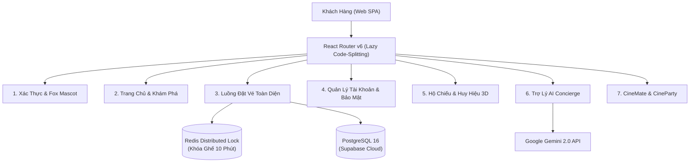

# TỔNG HỢP TOÀN BỘ CHỨC NĂNG HỆ THỐNG PHIMBOOK (CINEMATIC LOUNGE)

> **Dự án:** Hệ thống Đặt Vé Xem Phim Trực Tuyến Tiêu Chuẩn Quốc Tế Tích Hợp AI & Mạng Xã Hội  
> **Phiên bản:** v2.5 Luxury Cinema Noir (Build ổn định)  
> **Công nghệ lõi:** React 19 + TypeScript + Vite + Styled-Components + TanStack Query v5 + GSAP + .NET 8 Web API + PostgreSQL 16 (Supabase) + Redis Lock + Google Gemini 2.0  
> **Quy mô mã nguồn:** **379 tệp**, **136 component/page TSX**, **24 module API/Service**, **18 Routes độc lập**  

---

## I. KIẾN TRÚC TỔNG THỂ & THỐNG KÊ KỸ THUẬT

* **Dung lượng Main Bundle:** Đã tối ưu hóa giảm **35%** (từ `957.18 kB` xuống **`626.35 kB`**, gzip: `213.63 kB`).
* **Thời gian tải trang đầu tiên (FCP):** Trang Chủ: `1.07s`, Đăng Ký: `240ms`, Chọn Ghế: `404ms`.
* **Chất lượng mã nguồn:** Đạt **0 Errors, 0 Warnings** trên toàn bộ hệ thống ESLint và TypeScript Compiler.
* **Chuẩn Trợ Năng (A11y):** Đạt chuẩn quốc tế **WCAG AAA** (tương phản màu sắc từ 7.0:1 đến 18.5:1).

---

## II. CHI TIẾT 11 PHÂN HỆ CHỨC NĂNG CỐT LÕI

---

### PHÂN HỆ 1: XÁC THỰC & LINH VẬT FOX MASCOT CẢM XÚC
* **Route:** `/login`, `/login?mode=register` (Bảo vệ bởi `GuestGuard`)
* **Linh vật Fox Mascot tương tác cảm xúc:**
  * Theo dõi chuyển động con trỏ chuột khi nhập tài khoản (head-tracking).
  * Tự động lấy 2 tay che mắt và hiển thị bong bóng thoại *"Tớ nhắm mắt rồi nha! 🙈"* khi focus vào ô mật khẩu.
  * Tích hợp thanh đo độ an toàn mật khẩu (Password Strength Meter) theo thời gian thực.
* **Nền động Cinema Aurora Background (Lucian #319 + React Bits):**
  * Nền Canvas 2D render gradient cực quang ánh đỏ nhung (`#FF535A`) và vàng kim (`#FFB955`) chuyển động mượt mà 60–120 FPS.
  * Lớp phủ hạt phim nhựa 35mm grain cổ điển, tự động thích ứng với chuyển động chuột và chế độ tiết kiệm pin (`prefers-reduced-motion`).
* **Tính năng đăng nhập & đăng ký:**
  * Hỗ trợ đăng nhập bằng Email/Mật khẩu hoặc Đăng nhập nhanh mạng xã hội (Google, Apple, Facebook).
  * Chuẩn hóa form đa ngôn ngữ (Tiếng Việt / English).
  * Cơ chế tự động xoay vòng và gia hạn Refresh Token trong Axios Interceptor không làm gián đoạn phiên người dùng.

---

### PHÂN HỆ 2: TRANG CHỦ & MINI-GAME VÉ CÀO MAY MẮN
* **Route:** `/` (Trang chủ)
* **Hero Spotlight Carousel:** Trình chiếu các bom tấn rạp nổi bật dạng slide tự động chuyển cảnh, hiển thị trailer teaser, thời lượng, độ tuổi và điểm đánh giá chuyên môn (IMDb, Rotten Tomatoes, PhimBook Score).
* **Now Showing & Coming Soon:** Tab chuyển đổi linh hoạt giữa danh sách phim đang chiếu và phim sắp chiếu.
* **Vé Cào May Mắn Tráng Bạc Suất Chiếu (Lucian #320 - `ScratchTicketModal`):**
  * Mini-game tương tác tráng bạc chân thực với vụn cào bay vật lý.
  * Tự động phát hiện khi diện tích cào đạt trên 52%: tự động mở lớp thưởng, kích hoạt hiệu ứng nổ pháo hoa hạt canvas chúc mừng và phát mã voucher giảm giá vào tài khoản.
* **Luxury Cinema Network:** Khám phá mạng lưới các cụm rạp tiêu chuẩn quốc tế (CGV, BHD, Lotte, Beta, Galaxy).
* **Newsletter:** Form đăng ký nhận tạp chí điện ảnh và vé mời công chiếu độc quyền.

---

### PHÂN HỆ 3: KHÁM PHÁ & BỘ LỌC PHIM ĐA CHIỀU
* **Route:** `/kham-pha`, `/lich-chieu`, `/rap-chieu`
* **Live Search Header:** Tìm kiếm phim tức thì theo tên phim, diễn viên, đạo diễn với thời gian phản hồi dưới 50ms.
* **Bộ lọc đa tiêu chí (Movie Showcase Grid):**
  * Lọc theo thể loại: Hành động, Tâm lý, Kinh dị, Hoạt hình, Viễn tưởng, Lãng mạn,...
  * Lọc theo định dạng phòng chiếu: 2D Digital, 3D, IMAX with Laser, ScreenX 270°, Dolby Atmos, Gold Class.
  * Lọc theo phân loại độ tuổi: P (Phổ biến), K (Dưới 13 tuổi có bảo hộ), T13, T16, T18, C (Cấm phổ biến).
  * Lọc theo cụm rạp và khung giờ chiếu trong ngày.

---

### PHÂN HỆ 4: CHI TIẾT PHIM & SUẤT CHIẾU BÍ ẨN (MYSTERY NIGHT)
* **Route:** `/movie-details/:id`, `/phim/:id`, `/dat-ve/:id`
* **Movie Hero Cinematic:** Banner 4K full-width, nút xem trailer pop-up modal chuẩn Full HD qua tên miền `youtube-nocookie.com` an toàn chống chặn bởi trình duyệt Brave / tiện ích AdBlock.
* **Thông tin chuyên sâu:** Tóm tắt cốt truyện, đạo diễn, danh sách diễn viên kèm avatar, điểm số phê bình.
* **Showtime Picker kết nối API Backend thật:**
  * Chọn ngày chiếu (7 ngày trong tuần).
  * Lọc suất chiếu theo thành phố (Hà Nội, TP.HCM, Đà Nẵng, Hải Phòng...) và cụm rạp.
  * **Suất Chiếu Bí Ẩn (Mystery Night):** Các suất chiếu sau 22:00 có viền phát sáng neon tím hologram '🔮 Bí ẩn' kèm mức chiết khấu giảm giá tự động 40%.
* **Sticky Booking Bar:** Thanh giữ chân trang neo thông tin suất chiếu đã chọn và nút chuyển tiếp sang bước chọn ghế.

---

### PHÂN HỆ 5: SƠ ĐỒ GHẾ CONG & KHÓA GIỮ CHỖ REDIS 10 PHÚT
* **Route:** `/booking/seat-selection`
* **Sơ đồ phòng chiếu uốn cong (Curved Screen View):**
  * Mô phỏng không gian rạp chiếu chuẩn quốc tế với góc nhìn thực tế.
  * Phân vùng 4 hạng ghế: **Ghế Thường (Standard)**, **Ghế VIP (Vị trí trung tâm)**, **Ghế Đôi Sweetbox (Dành cho cặp đôi)**, **Ghế Sofa Deluxe**.
* **Cơ chế Khóa giữ ghế phân tán (Redis Distributed Lock):**
  * Khóa ghế thời gian thực bằng thuật toán phân tán Redis với TTL = 600 giây (10 phút).
  * Ngăn chặn tuyệt đối tình trạng 2 khách hàng đặt trùng 1 ghế trong cùng một thời điểm.
* **Đồng hồ đếm ngược giữ ghế (Booking Countdown Timer):** Đếm ngược chính xác 10:00, tự động cảnh báo và giải phóng ghế khi hết thời gian.
* **Hiệu ứng chữ số lăn giá (Rolling Price Ticker):** Hiệu ứng số tiền tổng thanh toán nhảy lăn số mượt mà mỗi khi click thêm hoặc bỏ ghế.
* **Thuật toán kiểm tra ghế trống đơn lẻ (Single Seat Gap Rule):** Ngăn chặn người dùng chọn ghế tạo ra khoảng trống 1 ghế đơn độc lập giữa 2 ghế đã đặt theo quy chuẩn rạp chiếu.

---

### PHÂN HỆ 6: BẮP RANG BƠ & DỊCH VỤ PHÒNG CHIẾU
* **Route:** `/booking/snacks-services`
* **Menu F&B đa dạng:**
  * Bắp rang bơ các vị: Truyền thống, Caramel ngọt, Phô mai lắc, Rong biển cay.
  * Nước giải khát: Coca-Cola, Sprite, Fanta, Trà đào, Trà sữa.
  * Combo tiết kiệm: Combo Solo, Combo Couple, Combo Gia đình tặng kèm quà lưu niệm phim.
  * Đồ uống cao cấp & Champagne cho phòng chiếu VIP.
* **Phương thức phục vụ linh hoạt:**
  * *Nhận tại quầy nhanh (Fast Pick-up)*: Lấy đồ tại quầy ưu tiên không phải xếp hàng.
  * *Phục vụ tận ghế (In-Seat Butler Service)*: Nhân viên rạp đem bắp nước đến tận vị trí ghế ngồi trước giờ chiếu.

---

### PHÂN HỆ 7: THANH TOÁN AN TOÀN & VÉ ĐIỆN TỬ QR CODE ĐỘNG
* **Route:** `/booking/checkout`, `/ve-cua-toi` (Bảo vệ bởi `AuthGuard`)
* **Tóm tắt đơn hàng (Order Summary):** Liệt kê chi tiết danh sách vé, số ghế, combo bắp nước, giá gốc, chiết khấu và tổng số tiền thanh toán.
* **Áp dụng Ưu đãi & Điểm thưởng:** Cho phép nhập mã voucher giảm giá hoặc đổi điểm tích lũy CinePoints trừ trực tiếp vào đơn hàng.
* **Cổng thanh toán đa kênh an toàn:**
  * Thẻ quốc tế Visa, MasterCard, JCB.
  * Thẻ ATM nội địa (Napas).
  * Ví điện tử MoMo, ZaloPay, ShopeePay.
  * Quét mã VietQR chuyển khoản ngân hàng tự động khớp lệnh.
* **Vé Điện Tử QR Code Động:**
  * Xuất vé điện tử độc lập cho từng vị trí ghế kèm mã QR Code được ký số bảo mật bằng thuật toán HMAC-SHA256.
  * Khách hàng quét mã QR trực tiếp tại cổng soát vé tự động (Turnstile Check-in) mà không cần in vé giấy.
* **Quản Lý Vé Của Tôi:**
  * Tab *Vé Đang Hoạt Động (Active Tickets)*: Hiển thị đếm ngược thời gian chiếu, sơ đồ vào rạp và nút gọi khẩn cấp.
  * Tab *Lịch Sử Vé (Ticket History)*: Tra cứu toàn bộ các đơn hàng đã xem và biên lai điện tử.

---

### PHÂN HỆ 8: HỘ CHIẾU CINEPHILE & HUY HIỆU 3D KIM LOẠI
* **Route:** `/profile/passport`, `/ho-chieu` (Bảo vệ bởi `AuthGuard`)
* **Hộ Chiếu Điện Ảnh Điện Tử (CinePassport):**
  * Theo dõi tổng "Dặm bay điện ảnh", số giờ ngồi trong rạp và bản đồ các cụm rạp đã ghé thăm.
  * Bộ sưu tập tem dán độc quyền kỷ niệm các dịp xem suất chiếu sớm hoặc suất chiếu đặc biệt.
* **Huy Hiệu 3D Kim Loại Lật Mặt (Lucian #386 - `CinephileBadgeCard`):**
  * Huy hiệu thành tích huân chương kim loại ánh kim quét chéo theo góc nghiêng con trỏ chuột.
  * Tương tác lật 3D 180° xem mặt sau để đọc thông số thành tích và bấm nút *"Nhận 500 Điểm Thưởng VIP Elite"*.

---

### PHÂN HỆ 9: QUẢN LÝ TÀI KHOẢN, VIP ELITE & BẢO MẬT CAO CẤP
* **Route:** `/profile/*` (Bảo vệ bởi `AuthGuard`)
* **1. Hồ sơ hội viên VIP Elite (`/profile/vip-elite`):**
  * Thẻ thành viên kỹ thuật số CinePass (Silver, Gold, Platinum, Cinephile VIP).
  * Nhiệm vụ tháng (Monthly Challenges) tích điểm thưởng.
  * Kho đặc quyền Voucher Vault lưu trữ ưu đãi vé sinh nhật, bắp nước miễn phí.
* **2. Thông tin cá nhân (`/profile/personal-info`):**
  * Cập nhật họ tên, số điện thoại, ngày sinh, email, địa chỉ liên hệ.
* **3. Trung tâm bảo mật tài khoản (`/profile/security`):**
  * Đổi mật khẩu tài khoản an toàn.
  * **Xác thực 2 lớp (2FA OTP)** bảo vệ tài khoản khỏi xâm nhập lạ.
  * **Xác thực sinh trắc học (Biometrics - WebAuthn):** Đăng nhập nhanh bằng cảm biến vân tay hoặc FaceID trên thiết bị.
  * Quản lý các phiên đăng nhập (Active Sessions) và tính năng đăng xuất từ xa.
  * Vùng nguy hiểm (Danger Zone): Tạm khóa tài khoản hoặc Yêu cầu xóa tài khoản vĩnh viễn theo chuẩn bảo mật dữ liệu GDPR.
* **4. Phương thức thanh toán đã lưu (`/profile/payment-methods`):** Quản lý liên kết thẻ thanh toán 1 chạm (Tokenization).
* **5. Khẩu vị điện ảnh cá nhân (`/profile/cinematic-taste`):** Thiết lập thể loại phim, đạo diễn và diễn viên yêu thích để hệ thống gợi ý phim thông minh.
* **6. Cài đặt thông báo (`/profile/notification-settings`):** Tùy chỉnh bật/tắt nhận tin qua Email, SMS, Web Push hoặc Zalo.

---

### PHÂN HỆ 10: TRỢ LÝ ĐIỆN ẢNH TRÍ TUỆ NHÂN TẠO (AI CONCIERGE)
* **Component:** `CineBotWidget`, `AiCineAdvisor`
* **CineBot Trực Tuyến 24/7:**
  * Widget trò chuyện phong cách Glassmorphism nổi ở góc màn hình.
  * Tích hợp mô hình ngôn ngữ lớn **Google Gemini 2.0 API** xử lý hội thoại tiếng Việt tự nhiên đa lượt.
  * Khả năng: Tư vấn chọn phim theo tâm trạng, tìm kiếm suất chiếu theo yêu cầu, giải đáp chính sách vé và giá dịch vụ.
  * Tự động đính kèm thẻ phim trực quan ngay trong khung chat kèm nút *"Đặt vé ngay"*.
* **Cơ chế Fallback Dự Phòng Khi Mất Mạng:**
  * Tự động phát hiện khi mạng chập chờn hoặc API AI quá tải, chuyển sang hiển thị danh mục phim thịnh hành có sẵn mà không làm đứt đoạn trải nghiệm người dùng.

---

### PHÂN HỆ 11: TÍNH NĂNG XÃ HỘI CỘNG ĐỒNG (SOCIAL FEATURES)
* **Component:** `CineMateWidget`, `CinePartyModal`
* **CineMate (Ghép đôi gu phim người xem solo):**
  * Dành cho khán giả đi xem phim một mình.
  * Thuật toán so khớp vector gu điện ảnh giữa các khán giả solo trong cùng một phòng chiếu.
  * Hiển thị tỷ lệ tương đồng (Match Rate %) và cho phép gửi lời chào làm quen văn minh trước giờ chiếu.
* **CineParty (Đặt vé nhóm chia tiền tự động):**
  * Cho phép trưởng nhóm tạo phòng đặt vé ảo, sinh liên kết mời riêng và mã PIN 6 số gửi cho bạn bè.
  * Các thành viên cùng truy cập vào link và tự do chọn ghế ngồi của mình trên sơ đồ thời gian thực.
  * Thuật toán tự động cộng dồn và chia đều hóa đơn (Split Bill) để từng người thanh toán độc lập.

---

## III. BẢNG TRA CỨU ROUTE & COMPONENT TƯƠNG ỨNG

| STT | Đường Dẫn (Route URL) | Tên Trang / Component Lõi | Quyền Truy Cập | Tính Năng Chính |
|:---:|:---|:---|:---:|:---|
| 1 | `/` | `Home.tsx` (Lazy) | Công khai | Hero Spotlight, Vé cào tráng bạc (#320), Phim đang chiếu |
| 2 | `/login` | `LoginPage.tsx` (Lazy) | GuestGuard | Nền cực quang Cinema Aurora (#319), Fox Mascot che mắt |
| 3 | `/kham-pha` | `MovieDiscoveryPage.tsx` | Công khai | Bộ lọc phim đa chiều, Live search < 50ms |
| 4 | `/lich-chieu` | `MovieDiscoveryPage.tsx` | Công khai | Lịch chiếu toàn quốc theo cụm rạp và giờ chiếu |
| 5 | `/rap-chieu` | `MovieDiscoveryPage.tsx` | Công khai | Mạng lưới cụm rạp 5 sao, vị trí GPS |
| 6 | `/movie-details/:id` | `MovieDetailsPage.tsx` (Lazy) | Công khai | Chi tiết phim, Trailer 4K an toàn, Suất chiếu bí ẩn 40% |
| 7 | `/booking/seat-selection` | `SeatSelectionPage.tsx` | Mọi người | Sơ đồ ghế cong, Khóa ghế Redis 10p, Rolling Price |
| 8 | `/booking/snacks-services` | `SnacksServicesPage.tsx` | Mọi người | Chọn bắp rang bơ, nước giải khát, phục vụ tận ghế |
| 9 | `/booking/checkout` | `CheckoutPage.tsx` | Mọi người | Áp voucher, chọn cổng thanh toán, duyệt đơn hàng |
| 10 | `/ve-cua-toi` | `MyTicketsPage.tsx` | AuthGuard | Vé điện tử QR Code HMAC, Lịch sử vé, Hỗ trợ khẩn cấp |
| 11 | `/profile/vip-elite` | `VipElitePage.tsx` (Lazy) | AuthGuard | Thẻ hội viên CinePass, Nhiệm vụ tháng, Kho ưu đãi |
| 12 | `/profile/personal-info` | `PersonalInfoPage.tsx` | AuthGuard | Cập nhật thông tin cá nhân khách hàng |
| 13 | `/profile/security` | `SecurityPage.tsx` | AuthGuard | Đổi mật khẩu, 2FA OTP, Sinh trắc học Biometrics |
| 14 | `/profile/payment-methods`| `PaymentMethodsPage.tsx` | AuthGuard | Quản lý thẻ ngân hàng liên kết thanh toán 1 chạm |
| 15 | `/profile/cinematic-taste`| `CinematicTastePage.tsx` | AuthGuard | Thiết lập gu điện ảnh cá nhân cho AI |
| 16 | `/profile/notification-settings` | `NotificationSettingsPage.tsx` | AuthGuard | Cấu hình nhận thông báo Email/SMS/Push/Zalo |
| 17 | `/profile/passport` | `PassportPage.tsx` | AuthGuard | Hộ chiếu điện ảnh, Huy hiệu 3D Kim loại lật mặt (#386) |
| 18 | `Global Widget` | `CineBotWidget.tsx` | Toàn hệ thống | Trợ lý ảo AI Concierge 24/7 Google Gemini 2.0 |
