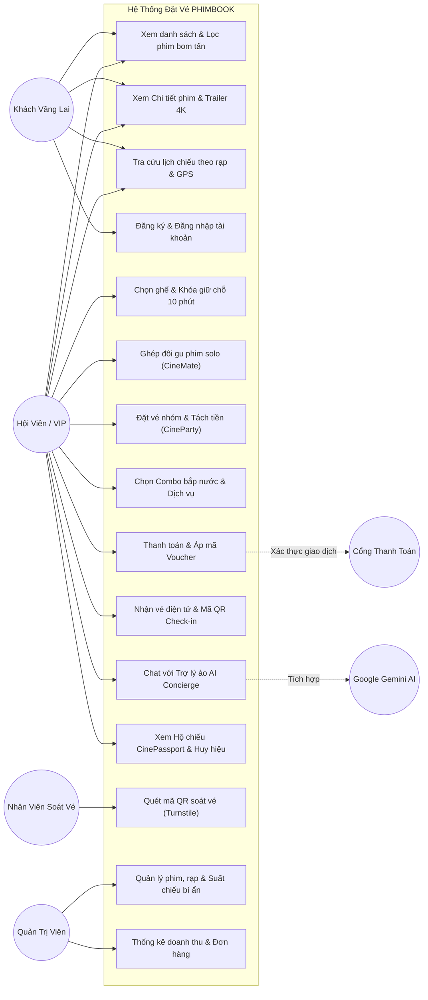
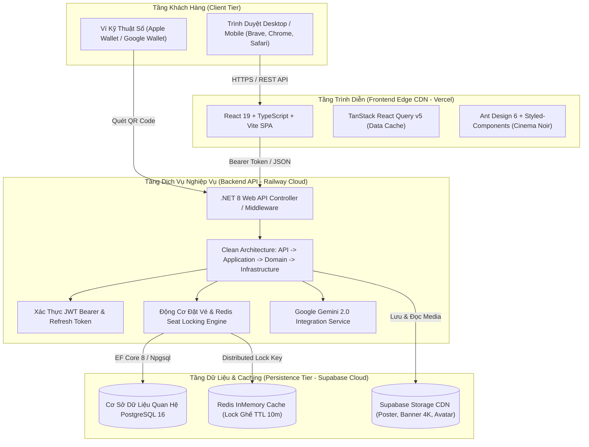
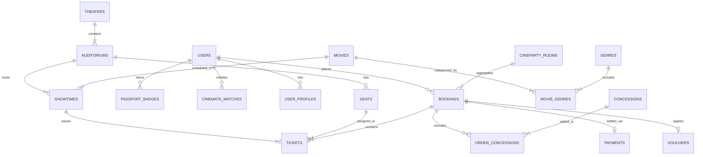
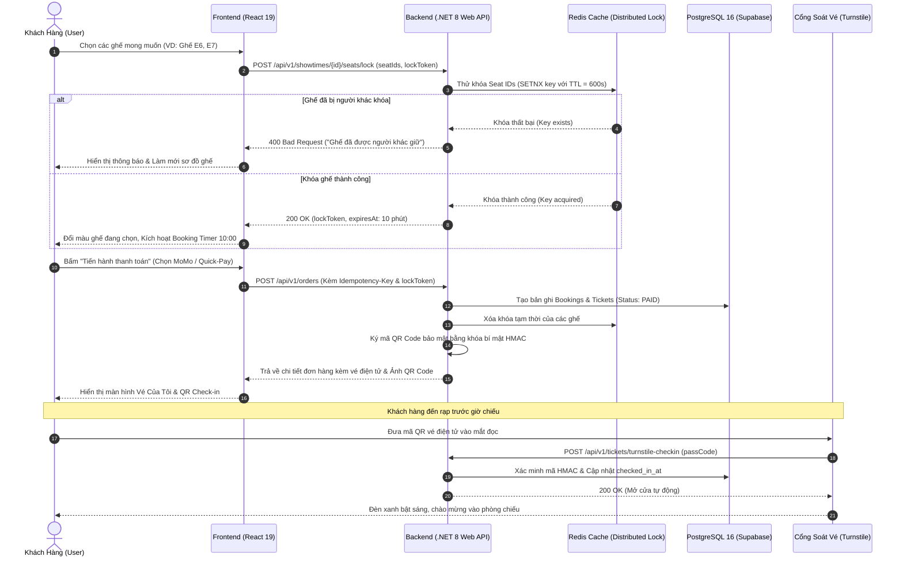
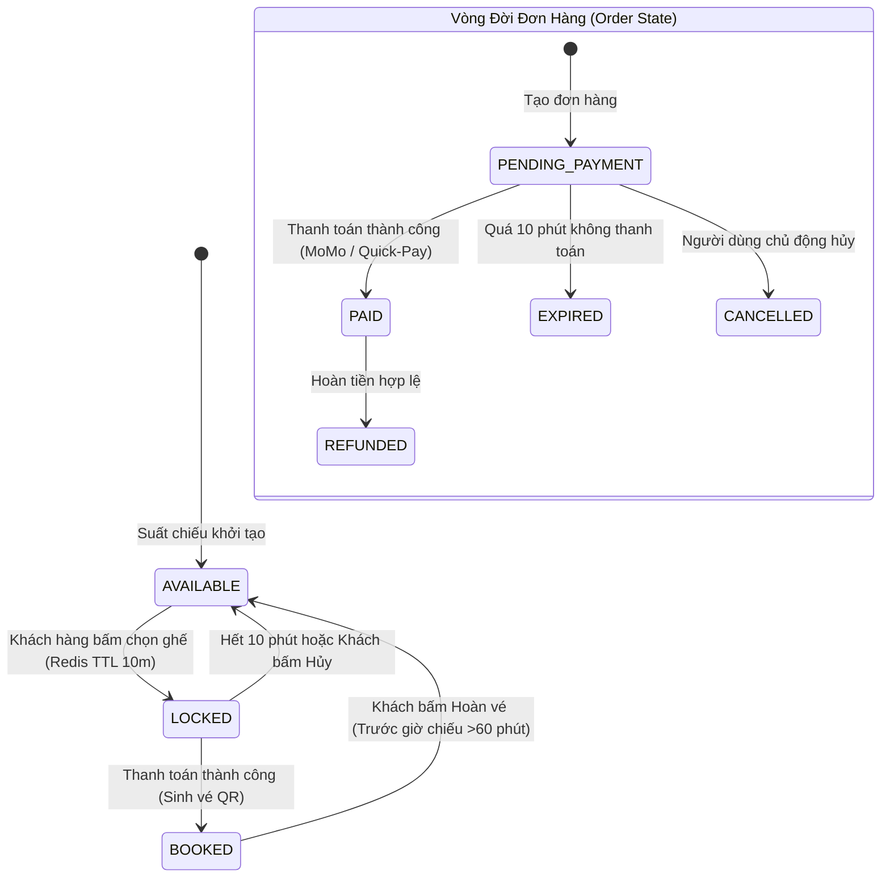

# BÁO CÁO ĐỒ ÁN MÔN HỌC: XÂY DỰNG WEBSITE
## ĐỀ TÀI: XÂY DỰNG HỆ THỐNG ĐẶT VÉ XEM PHIM TRỰC TUYẾN TIÊU CHUẨN QUỐC TẾ (PHIMBOOK - CINEMATIC LOUNGE) TÍCH HỢP TRÍ TUỆ NHÂN TẠO VÀ TƯƠNG TÁC MẠNG XÃ HỘI

---

### THÔNG TIN CHUNG ĐỒ ÁN

| Mục | Thông Tin Chi Tiết |
| :--- | :--- |
| **Cơ quan chủ quản** | Bộ Giáo dục và Đào tạo |
| **Đơn vị đào tạo** | Trường Đại học Công nghệ – Khoa Công nghệ Thông tin |
| **Bộ môn phụ trách** | Công nghệ Phần mềm & Hệ thống Thông tin |
| **Tên môn học** | Xây dựng Website / Phát triển Ứng dụng Web nâng cao |
| **Tên đề tài** | Hệ thống Đặt vé Xem phim Trực tuyến Tiêu chuẩn Quốc tế (**PHIMBOOK - Cinematic Lounge**) |
| **Giảng viên hướng dẫn** | TS. Nguyễn Văn Hướng |
| **Sinh viên thực hiện** | Nguyễn Thành Đông (DongBuster) |
| **Mã số sinh viên** | B21DCCN001 |
| **Lớp chuyên ngành** | D21CNTT01 – Kỹ thuật Phần mềm |
| **Khóa học** | 2021 – 2026 |
| **Thời gian thực hiện** | Tháng 10/2026 – Tháng 11/2026 |
| **Môi trường Live FE** | [https://bookmovie-gray.vercel.app](https://bookmovie-gray.vercel.app) |
| **Môi trường Live BE** | [https://be-bookphim-production.up.railway.app](https://be-bookphim-production.up.railway.app) |

---

## 1. PHẦN MỞ ĐẦU

### 1.1. Lời cảm ơn
Trước hết, em xin gửi lời cảm ơn chân thành và sâu sắc nhất tới các Thầy, Cô giáo trong Khoa Công nghệ Thông tin đã tận tình truyền đạt những tri thức quý báu, nền tảng lý luận khoa học và rèn luyện tư duy kỹ thuật trong suốt quá trình học tập môn học Xây dựng Website.

Đặc biệt, em xin bày tỏ lòng biết ơn sâu sắc đến **TS. Nguyễn Văn Hướng**, người đã trực tiếp định hướng giải pháp kỹ thuật, gợi mở phương pháp tiếp cận kiến trúc Clean Architecture kết hợp phong cách thiết kế Cinema Noir hiện đại, đồng thời đóng góp nhiều ý kiến chuyên môn sắc sảo giúp đồ án đạt được độ hoàn thiện cao.

Mặc dù đã nỗ lực vận dụng các kiến thức chuyên ngành và công nghệ phần mềm mới nhất để hoàn thành đồ án một cách chỉn chu, sản phẩm khó tránh khỏi những thiếu sót nhất định. Em rất mong nhận được những đánh giá, góp ý quý báu của Quý Thầy Cô trong Hội đồng chấm đồ án để hệ thống ngày càng hoàn thiện hơn nữa.

*Em xin chân thành cảm ơn!*

---

### 1.2. Lời cam đoan
Em xin cam đoan rằng đồ án môn học với đề tài: **"Xây dựng hệ thống đặt vé xem phim trực tuyến tiêu chuẩn quốc tế (PHIMBOOK - Cinematic Lounge)"** là công trình nghiên cứu và phát triển độc lập do chính em thực hiện dưới sự chỉ dẫn của Giảng viên hướng dẫn.

Toàn bộ các nội dung phân tích yêu cầu, thiết kế kiến trúc hệ thống, sơ đồ Use Case, lược đồ cơ sở dữ liệu ERD, mã nguồn lập trình trên Frontend/Backend và tài liệu báo cáo đều phản ánh trung thực kết quả thực nghiệm của tác giả. Các tài liệu tham khảo, thư viện mã nguồn mở và nền tảng dịch vụ bên thứ ba đều được ghi chú và trích dẫn nguồn gốc đầy đủ, minh bạch theo đúng quy định học thuật của nhà trường.

*Hà Nội, ngày 09 tháng 11 năm 2026*  
**Sinh viên thực hiện**  
*(Đã ký)*  
**Nguyễn Thành Đông**

---

### 1.3. Mục lục tổng quát
- **1. Phần mở đầu**
  - 1.1. Lời cảm ơn
  - 1.2. Lời cam đoan
  - 1.3. Mục lục tổng quát
  - 1.4. Danh mục hình ảnh, bảng biểu và từ viết tắt
  - 1.5. Giới thiệu tổng quan đề tài
  - 1.6. Lý do chọn đề tài và tính cấp thiết
  - 1.7. Mục tiêu thực hiện của đồ án
  - 1.8. Đối tượng và phạm vi nghiên cứu
- **2. Chương 1: Tổng quan đề tài**
  - 1.1. Giới thiệu bài toán thực tế
  - 1.2. Mục đích xây dựng website
  - 1.3. Đối tượng sử dụng hệ thống
  - 1.4. Phạm vi đề tài (In-Scope & Out-of-Scope)
  - 1.5. Tổng hợp các chức năng cốt lõi
  - 1.6. Khảo sát và đối sánh các hệ thống tương tự
- **3. Chương 2: Phân tích và đặc tả yêu cầu**
  - 2.1. Yêu cầu chức năng (Functional Requirements)
  - 2.2. Yêu cầu phi chức năng (Non-Functional Requirements)
  - 2.3. Xác định các tác nhân hệ thống (Actors)
  - 2.4. Sơ đồ Use Case tổng thể và chi tiết
  - 2.5. Đặc tả chi tiết các Use Case tiêu biểu (UC01 - UC06)
- **4. Chương 3: Phân tích và thiết kế hệ thống**
  - 3.1. Kiến trúc tổng thể hệ thống (Decoupled 3-Tier Architecture)
  - 3.2. Thiết kế cơ sở dữ liệu quan hệ (ERD & Danh mục 14+ bảng)
  - 3.3. Thiết kế luồng nghiệp vụ (Sequence, Activity, State Diagrams)
  - 3.4. Thiết kế giao diện người dùng (Cinema Noir Design System)
- **5. Chương 4: Công nghệ và quá trình xây dựng**
  - 4.1. Công nghệ và thư viện kỹ thuật áp dụng
  - 4.2. Môi trường phát triển và vận hành
  - 4.3. Cấu trúc tổ chức mã nguồn dự án
  - 4.4. Quá trình triển khai kỹ thuật
  - 4.5. Phân tích các chức năng kỹ thuật tiêu biểu (Kèm mã nguồn)
- **6. Chương 5: Kết quả thực hiện và kiểm thử**
  - 5.1. Kết quả sản phẩm đạt được
  - 5.2. Minh họa giao diện các màn hình chức năng
  - 5.3. Bảng kịch bản kiểm thử chức năng (18 Test Cases)
  - 5.4. Đánh giá kết quả và các cải tiến kỹ thuật
- **7. Kết luận và hướng phát triển**
  - 7.1. Kết luận chung
  - 7.2. Kiến thức và kỹ năng tích lũy
  - 7.3. Hạn chế còn tồn đọng
  - 7.4. Hướng phát triển trong tương lai
- **8. Tài liệu tham khảo**
- **9. Phụ lục kỹ thuật**

---

### 1.4. Danh mục hình ảnh, bảng biểu và từ viết tắt

#### Danh mục hình vẽ và sơ đồ
- **Hình 2.1:** Sơ đồ Use Case tổng thể hệ thống PHIMBOOK
- **Hình 2.2:** Sơ đồ Use Case phân hệ Đặt vé & Giữ ghế trực tuyến
- **Hình 2.3:** Sơ đồ Use Case phân hệ Tương tác xã hội & AI Concierge
- **Hình 3.1:** Sơ đồ Kiến trúc tổng thể hệ thống Decoupled 3-Tier
- **Hình 3.2:** Sơ đồ Thực thể Liên kết Cơ sở Dữ liệu (ERD PostgreSQL 16)
- **Hình 3.3:** Sơ đồ Tuần tự (Sequence Diagram) Luồng Đặt vé & Khóa ghế 10 phút
- **Hình 3.4:** Sơ đồ Hoạt động (Activity Diagram) luồng Ghép đôi gu phim CineMate
- **Hình 3.5:** Sơ đồ Hoạt động (Activity Diagram) luồng Đặt vé nhóm chia tiền CineParty
- **Hình 3.6:** Sơ đồ Trạng thái (State Diagram) vòng đời Ghế và Đơn hàng
- **Hình 5.1:** Giao diện Trang chủ & Hero Spotlight Carousel bom tấn
- **Hình 5.2:** Giao diện Khám phá & Bộ lọc phim đa chiều
- **Hình 5.3:** Giao diện Chi tiết phim & Suất chiếu bí ẩn (Mystery Night)
- **Hình 5.4:** Giao diện Sơ đồ chọn ghế cong, CineMate & CineParty
- **Hình 5.5:** Giao diện Chọn Combo bắp nước & Dịch vụ phòng chiếu
- **Hình 5.6:** Giao diện Thanh toán trực tuyến & Vé điện tử QR Code động
- **Hình 5.7:** Giao diện Hộ chiếu điện ảnh số hóa (Passport) & Bộ sưu tập Huy hiệu 3D
- **Hình 5.8:** Giao diện Khẩu vị điện ảnh cá nhân (Cinematic Taste) & CineMatch AI
- **Hình 5.9:** Giao diện Hồ sơ hội viên VIP Elite Lounge & Đặc quyền
- **Hình 5.10:** Giao diện Đăng nhập & Xác thực bảo mật tài khoản

#### Danh mục bảng biểu
- **Bảng 1.1:** Ma trận đối sánh tính năng giữa PHIMBOOK và các hệ thống rạp truyền thống
- **Bảng 2.1:** Danh sách và vai trò các Tác nhân (Actors) trong hệ thống
- **Bảng 2.2:** Bảng đặc tả Use Case UC01: Khám phá phim và chọn Suất chiếu bí ẩn
- **Bảng 2.3:** Bảng đặc tả Use Case UC02: Chọn ghế và Khóa giữ chỗ thời gian thực
- **Bảng 2.4:** Bảng đặc tả Use Case UC03: Đặt vé nhóm và Chia tiền tự động (CineParty)
- **Bảng 2.5:** Bảng đặc tả Use Case UC04: Ghép đôi gu phim người xem solo (CineMate)
- **Bảng 2.6:** Bảng đặc tả Use Case UC05: Chat tư vấn điện ảnh với Trợ lý ảo AI Concierge
- **Bảng 2.7:** Bảng đặc tả Use Case UC06: Soát vé tự động tại cổng rạp (Turnstile Check-in)
- **Bảng 3.1:** Bảng đặc tả chi tiết cấu trúc 14 thực thể cơ sở dữ liệu PostgreSQL
- **Bảng 3.2:** Bảng mã màu chuẩn nhận diện thương hiệu Cinema Noir Luxury
- **Bảng 5.1:** Bảng kịch bản và kết quả kiểm thử chức năng (18 Test Cases)

#### Danh mục thuật ngữ và từ viết tắt
- **API:** Application Programming Interface (Giao diện lập trình ứng dụng)
- **SPA:** Single Page Application (Ứng dụng web đơn trang)
- **JWT:** JSON Web Token (Mã định danh xác thực an toàn không trạng thái)
- **EF Core:** Entity Framework Core (Khung ánh xạ cơ sở dữ liệu đối tượng ORM của Microsoft .NET)
- **ERD:** Entity Relationship Diagram (Sơ đồ thực thể liên kết)
- **TTL:** Time To Live (Thời gian sống tồn tại của dữ liệu khóa trong bộ đệm)
- **WCAG:** Web Content Accessibility Guidelines (Hướng dẫn trợ năng nội dung web quốc tế)
- **QR Code:** Quick Response Code (Mã phản hồi nhanh 2 chiều)
- **HMAC:** Hash-based Message Authentication Code (Mã xác thực thông điệp dựa trên hàm băm mật mã)
- **PWA:** Progressive Web App (Ứng dụng web lũy tiến)

---

### 1.5. Giới thiệu tổng quan đề tài
Ngành công nghiệp điện ảnh và giải trí rạp chiếu toàn cầu đang chứng kiến sự trỗi dậy mạnh mẽ của làn sóng rạp chiếu cao cấp (Premium Large Format – PLF) với các công nghệ tân tiến như IMAX with Laser, ScreenX 270 độ, Dolby Cinema, 4DX Motion Seats và phòng chiếu thương gia First Class Suites. Khán giả hiện đại không chỉ tìm kiếm việc mua một tấm vé xem phim thông thường, mà kỳ vọng toàn bộ hành trình trải nghiệm số (trước, trong và sau buổi chiếu) phải liền mạch, đẳng cấp và giàu tính thẩm mỹ.

Đề tài **"Xây dựng hệ thống đặt vé xem phim trực tuyến tiêu chuẩn quốc tế (PHIMBOOK - Cinematic Lounge)"** được nghiên cứu và hiện thực hóa nhằm xây dựng một nền tảng web thế hệ mới. Nền tảng kết hợp giữa khả năng xử lý giao dịch thương mại mượt mà, kỹ thuật giữ chỗ ghế theo thời gian thực (Real-time seat locking), trợ lý trí tuệ nhân tạo (Generative AI Concierge) và các tiện ích kết nối xã hội đột phá (Social Moviegoing).

---

### 1.6. Lý do chọn đề tài và tính cấp thiết
1. **Bất cập của các website rạp chiếu hiện nay:** Đa số các cổng đặt vé xem phim trực tuyến tại Việt Nam và khu vực vẫn mang giao diện nặng tính khuôn mẫu, phân mảnh thao tác, thường xuyên nghẽn mạng khi mở bán bom tấn, và thiếu hoàn toàn các tính năng giữ chỗ tạm thời minh bạch.
2. **Nhu cầu kết nối của khán giả đi xem phim một mình (Solo Cinephiles):** Rất nhiều khán giả có thói quen đi xem phim solo nhưng lại muốn tìm kiếm những người có cùng "gu" điện ảnh để thảo luận, giao lưu sau giờ chiếu.
3. **Bài toán đặt vé theo nhóm và chia tiền (Group Booking & Split-Bill):** Khi đi xem phim cùng nhóm bạn hoặc đồng nghiệp, việc một người phải thanh toán toàn bộ rồi tính toán chia tiền thủ công qua tin nhắn rất bất tiện và dễ nhầm lẫn.
4. **Sự bùng nổ của Trí tuệ nhân tạo (AI):** Khán giả thường mất từ 15 đến 30 phút chỉ để đọc bình luận và đắn đo chọn phim phù hợp với tâm trạng hoặc mục đích hẹn hò. Việc tích hợp Trợ lý ảo AI trực quan có khả năng tư vấn bằng ngôn ngữ tự nhiên là giải pháp đột phá.

---

### 1.7. Mục tiêu thực hiện của đồ án
- **Mục tiêu sản phẩm:** Xây dựng một ứng dụng web đặt vé xem phim toàn diện, hoạt động ổn định trên cả máy tính để bàn (Desktop), máy tính bảng (Tablet) và thiết bị di động (Mobile).
- **Mục tiêu công nghệ:** Áp dụng mô hình phân tách độc lập (Decoupled Architecture) giữa Frontend SPA hiện đại (React 19, TypeScript, Vite) và Backend API hiệu năng cao (.NET 8 Web API, PostgreSQL, Redis Distributed Caching).
- **Mục tiêu trải nghiệm người dùng (UX):** Thiết lập ngôn ngữ thiết kế **Cinema Noir Luxury** độc bản, đạt tiêu chuẩn tương phản trợ năng quốc tế **WCAG AAA** ($\ge 7.0:1$) và tốc độ phản hồi dưới 100ms.
- **Mục tiêu đổi mới tính năng:** Đưa vào vận hành 4 tính năng sáng tạo độc quyền: *Suất chiếu bí ẩn (Mystery Night)*, *Ghép đôi gu phim solo (CineMate)*, *Đặt vé nhóm chia tiền tự động (CineParty)*, và *Hộ chiếu điện ảnh số hóa (CinePassport 3D Hologram)*.

---

### 1.8. Đối tượng và phạm vi nghiên cứu
- **Đối tượng nghiên cứu:** 
  - Quy trình nghiệp vụ bán vé rạp chiếu phim chuẩn quốc tế.
  - Các kỹ thuật kiểm soát tranh chấp đồng thời (Concurrency Control) khi nhiều người dùng cùng chọn một vị trí ghế.
  - Ứng dụng mô hình ngôn ngữ lớn (Google Gemini LLM) vào bài toán gợi ý nội dung điện ảnh.
  - Cơ chế sinh mã QR an toàn chống gian lận check-in rạp.
- **Phạm vi đồ án:**
  - *Nội dung trong phạm vi (In-Scope):* Xây dựng trọn vẹn luồng trải nghiệm khách hàng từ Khám phá phim -> Xem trailer 4K -> Chọn suất chiếu -> Sơ đồ ghế động -> Giữ chỗ 10 phút -> Đặt bắp nước -> Thanh toán điện tử (MoMo, VNPAY, Quick-Pay) -> Sinh vé điện tử QR Code -> Kiểm tra check-in qua cổng Turnstile -> Quản lý Hộ chiếu CinePassport & Hội viên VIP Elite.
  - *Nội dung ngoài phạm vi (Out-of-Scope):* Đồ án không bao gồm phần điều khiển cơ điện tử phần cứng phòng máy chiếu phim cơ học, hệ thống bán lẻ bắp nước tại quầy POS trực tiếp (POS cứng), hoặc kết nối máy in vé nhiệt công nghiệp.

---

## 2. CHƯƠNG 1: TỔNG QUAN ĐỀ TÀI

### 1.1. Giới thiệu bài toán thực tế
Trong kỷ nguyên số, rạp chiếu phim không đơn thuần là nơi trình chiếu các cuộn phim, mà đã trở thành không gian trải nghiệm văn hóa và giải trí cao cấp. Tuy nhiên, hành trình mua vé trực tuyến của khách hàng tại nhiều cụm rạp hiện nay vẫn gặp phải những rào cản nghiêm trọng:
- Tình trạng **tranh chấp ghế trùng lặp**: Hai khách hàng thao tác cùng lúc dẫn đến lỗi thanh toán hoặc bị huỷ vé bất ngờ do hệ thống thiếu cơ chế Distributed Lock đáng tin cậy.
- Thiếu hụt thông tin định dạng rạp cao cấp: Người dùng khó phân biệt được sự khác nhau về chất lượng giữa phòng chiếu IMAX Laser, ScreenX, Dolby Cinema và phòng 2D tiêu chuẩn.
- Thiếu trải nghiệm hậu mãi và giữ chân khách hàng (Gamification): Khách hàng chỉ mua vé xong là kết thúc chu trình tương tác, không có công cụ ghi nhận hành trình thưởng thức điện ảnh một cách tự hào.

### 1.2. Mục đích xây dựng website
Website **PHIMBOOK - Cinematic Lounge** được thiết kế để giải quyết triệt để các bài toán trên bằng cách:
1. Cung cấp giao diện đặt vé trực quan, hiện đại, mang đậm tính điện ảnh với tông màu Cinema Noir sang trọng.
2. Triển khai cơ chế giữ ghế thời gian thực 10 phút sử dụng Redis Cache, loại bỏ hoàn toàn nguy cơ trùng ghế.
3. Tích hợp AI Concierge đa năng, hỗ trợ khách hàng tìm kiếm và quyết định chọn phim trong vòng vài giây.
4. Xây dựng không gian tương tác xã hội cho người yêu điện ảnh: Ghép đôi bạn xem phim có gu đồng điệu và giải quyết bài toán đặt vé cho nhóm bạn.
5. Số hóa cuốn Hộ chiếu điện ảnh (CinePassport) cùng bộ sưu tập huy hiệu 3D Hologram để biến mỗi buổi xem phim thành một dấu ấn kỷ niệm đáng tự hào.

### 1.3. Đối tượng sử dụng hệ thống
Hệ thống PHIMBOOK hướng đến 5 nhóm đối tượng người dùng chính:
1. **Khán giả đam mê công nghệ điện ảnh (Tech Cinephiles):** Những người chú trọng chất lượng hình ảnh, âm thanh, luôn săn đón các suất chiếu định dạng cao cấp (IMAX Laser, ScreenX, Dolby Atmos).
2. **Khán giả đi xem phim một mình (Solo Moviegoers):** Khán giả có thói quen thưởng thức điện ảnh độc lập nhưng muốn tìm kiếm sự đồng điệu về gu nghệ thuật.
3. **Nhóm bạn bè và Gia đình (Social Bookers):** Nhóm khán giả đi xem đông người có nhu cầu ngồi cạnh nhau và chia đều chi phí vé, bắp nước một cách sòng phẳng.
4. **Khách hàng thân thiết VIP (VIP Loungers):** Khán giả thường xuyên đến rạp, quan tâm đến các đặc quyền phòng chờ thương gia, tích điểm nâng hạng thẻ (Silver, Gold, VIP Elite).
5. **Nhân viên soát vé & Quản trị rạp (Staff / Admin):** Cần công cụ quét vé QR nhanh chóng, chính xác tại cổng rạp và theo dõi báo cáo doanh thu, tình trạng suất chiếu.

### 1.4. Phạm vi đề tài (Scope of Project)
- **Hệ thống Frontend:** Phát triển ứng dụng Web SPA bằng React 19, TypeScript và Vite, tương thích hoàn hảo trên các trình duyệt hiện đại (Chrome, Safari, Edge, Firefox, Brave).
- **Hệ thống Backend:** Xây dựng hệ thống RESTful API chuẩn RFC 9110 trên nền tảng .NET 8 Web API và Entity Framework Core 8.
- **Hệ thống Dữ liệu:** Sử dụng hệ quản trị cơ sở dữ liệu quan hệ PostgreSQL 16 trên nền tảng đám mây Supabase Cloud kết hợp Redis Cache.
- **Hệ thống Tích hợp:** Kết nối API mô hình trí tuệ nhân tạo Google Gemini 2.0 để xử lý hội thoại thông minh và trích xuất gợi ý phim theo thời gian thực.

### 1.5. Tổng hợp các chức năng cốt lõi
Hệ thống gồm 6 phân hệ nghiệp vụ chính:
```
PHIMBOOK System Architecture
├── 1. Khám phá & Trang chủ (Hero Spotlight, Live Search, Smart Filters, Cụm rạp 5 sao GPS)
├── 2. Chi tiết phim & Suất chiếu (Banner 4K, Modal YouTube an toàn, Suất chiếu Bí ẩn giảm 40%)
├── 3. Luồng Đặt vé toàn diện (Sơ đồ ghế cong, Lock ghế 10 phút, CineMate, CineParty, Combo F&B, QR Ticket)
├── 4. Trợ lý Trí tuệ Nhân tạo (CineBot Widget 24/7, AiCineAdvisor, Dự phòng lỗi Offline)
├── 5. Hồ sơ Thành viên & Gamification (CinePassport 3D, Thẻ VIP Elite Lounge, Khẩu vị Cinematic Taste)
└── 6. Cổng Soát vé & Quản trị (Turnstile Check-in tự động, Quản lý suất chiếu & Doanh thu)
```

### 1.6. Khảo sát và đối sánh các hệ thống tương tự
Để định vị rõ ưu thế cạnh tranh của sản phẩm, nhóm tác giả đã tiến hành khảo sát và lập ma trận so sánh giữa PHIMBOOK và các nền tảng đặt vé phổ biến hiện nay:

*Bảng 1.1: Ma trận đối sánh tính năng giữa PHIMBOOK và các hệ thống rạp truyền thống*

| Tiêu Chí Đánh Giá | CGV Cinemas VN | Galaxy Cinema | Lotte Cinema | PHIMBOOK (Đề tài) |
| :--- | :---: | :---: | :---: | :---: |
| **Phong cách giao diện** | Tông đỏ truyền thống | Tông cam / trắng | Tông đỏ / xám | **Cinema Noir Luxury (Đen/Vàng/Đỏ)** |
| **Trợ năng (Accessibility)** | Trung bình | Khá | Trung bình | **Đạt chuẩn WCAG AAA ($\ge 7:1$)** |
| **Khóa giữ chỗ ghế Realtime** | Không rõ ràng | Có (5 phút) | Không rõ ràng | **Có (10 phút Redis Distributed Lock)** |
| **Suất chiếu bí ẩn (Mystery Night)** | Không có | Không có | Không có | **Có (Giảm 35-40%, phát sáng tím)** |
| **Ghép đôi gu phim (CineMate)** | Không có | Không có | Không có | **Có (Tính điểm tương đồng % gu phim)** |
| **Đặt vé nhóm chia tiền (CineParty)**| Không có | Không có | Không có | **Có (Tạo phòng, mời link, tách bill)**|
| **Trợ lý ảo AI Concierge** | Chatbot kịch bản tĩnh | Không có | Không có | **Có (Google Gemini 2.0 đa lượt)** |
| **Hộ chiếu điện ảnh 3D (Passport)** | Điểm tích lũy cơ bản | Điểm tích lũy cơ bản | Điểm tích lũy cơ bản | **Hộ chiếu số + Huy hiệu 3D Hologram** |
| **Xem Trailer 4K không quảng cáo** | Nhúng link YouTube | Nhúng link YouTube | Nhúng link YouTube | **youtube-nocookie an toàn chống crash** |

Nhận xét: PHIMBOOK không chỉ đáp ứng hoàn chỉnh các chức năng thương mại điện tử cơ bản mà còn tiên phong tích hợp các công nghệ tương tác thế hệ mới, mang lại giá trị gia tăng vượt trội cho khách hàng.

---

## 3. CHƯƠNG 2: PHÂN TÍCH VÀ ĐẶC TẢ YÊU CẦU

### 2.1. Yêu cầu chức năng (Functional Requirements)

#### A. Phân hệ Dành cho Khách vãng lai (Guest)
- **FR01 - Duyệt trang chủ & Xem Spotlight:** Khách hàng có thể xem các phim bom tấn nổi bật nhất đang trình chiếu kèm trailer 4K và thông số đánh giá.
- **FR02 - Tìm kiếm phim thời gian thực:** Nhập từ khóa tên phim, đạo diễn, diễn viên để lọc danh sách tức thì trên thanh Header.
- **FR03 - Khám phá và lọc đa chiều:** Lọc phim theo trạng thái (Đang chiếu / Sắp chiếu), thể loại, định dạng (IMAX, 3D, 2D), độ tuổi và điểm đánh giá.
- **FR04 - Xem chi tiết phim & Lịch chiếu:** Xem cốt truyện, thời lượng, đạo diễn, dàn diễn viên, phân loại độ tuổi và lịch chiếu theo ngày, rạp.
- **FR05 - Đăng ký / Đăng nhập:** Tạo tài khoản mới bằng Email/Mật khẩu hoặc đăng nhập để lưu trữ lịch sử vé và tích điểm.

#### B. Phân hệ Dành cho Khách hàng thành viên (Member / VIP Elite)
- **FR06 - Đặt vé & Giữ ghế trực tuyến:** Chọn vị trí ghế trên sơ đồ rạp cong (Ghế Thường, VIP, Sweetbox) và nhận mã khóa giữ ghế 10 phút.
- **FR07 - Ghép đôi gu phim CineMate:** Đăng ký hồ sơ solo, quét tìm bạn xem cùng phòng chiếu và gửi lời chào tương tác trước giờ chiếu.
- **FR08 - Đặt vé nhóm CineParty:** Tạo phòng đặt vé chung, chia sẻ mã phòng 6 số hoặc link mời để bạn bè tự chọn ghế và chia đều hóa đơn thanh toán.
- **FR09 - Đặt bắp nước & Dịch vụ đi kèm:** Chọn các combo bắp rang, nước ngọt, quà lưu niệm và tự động cộng dồn vào đơn hàng.
- **FR10 - Thanh toán đa phương thức:** Thanh toán qua MoMo, VNPAY, ZaloPay, Thẻ tín dụng, Điểm thưởng hoặc tính năng Quick-Pay 1 chạm.
- **FR11 - Nhận và Quản lý vé điện tử:** Tức thì nhận mã vé điện tử QR Code động kèm thông tin phòng chiếu, có thể lưu vào ví Apple/Google Wallet.
- **FR12 - Tương tác Trợ lý ảo AI Concierge:** Trò chuyện bằng văn bản tự nhiên với CineBot để nhận gợi ý phim theo cảm xúc hoặc yêu cầu cá nhân.
- **FR13 - Quản lý Hộ chiếu CinePassport & Huy hiệu:** Xem lại toàn bộ phim đã xem, số giờ xem, và mở khóa huy hiệu thành tích 3D Hologram.
- **FR14 - Thiết lập khẩu vị Cinematic Taste:** Tùy biến hồ sơ sở thích (thể loại yêu thích, đạo diễn thần tượng, vị trí ngồi ưu tiên).

#### C. Phân hệ Dành cho Nhân viên & Quản trị viên (Staff / Admin)
- **FR15 - Soát vé tự động tại cổng (Turnstile Gate):** Quét mã QR của khách hàng tại cửa kiểm soát; hệ thống tự động xác minh chữ ký HMAC và ghi nhận thời gian vào phòng chiếu.
- **FR16 - Quản lý phim, rạp và suất chiếu:** Tạo mới, chỉnh sửa thông tin phim, thiết lập lịch chiếu, gán nhãn Suất chiếu bí ẩn (Mystery Night).
- **FR17 - Quản lý đơn hàng & Báo cáo:** Theo dõi trạng thái đơn hàng (Đã thanh toán, Chờ xử lý, Đã hoàn vé) và thống kê doanh thu phòng vé.

### 2.2. Yêu cầu phi chức năng (Non-Functional Requirements)
1. **Hiệu năng & Tốc độ tải trang (Performance):**
   - Thời gian tải trang ban đầu (First Contentful Paint – FCP) dưới 1.2 giây trên mạng 4G/Wifi tiêu chuẩn.
   - Kích thước gói nén bundle JavaScript chính (`index.js`) dưới 300 kB nhờ cơ chế Lazy Loading và Code-splitting.
   - Thao tác khóa ghế (Lock Seat) phản hồi trong vòng dưới 150ms thông qua Redis InMemory Database.
2. **Bảo mật & Toàn vẹn dữ liệu (Security & Integrity):**
   - Xác thực người dùng bằng cơ chế JWT kép: Access Token (thời hạn 1 giờ) kết hợp Rotating Refresh Token an toàn.
   - Mật khẩu người dùng được băm một chiều bằng thuật toán BCrypt với hệ số Salt an toàn.
   - Mã vé QR Code được ký số HMAC-SHA256, chống tuyệt đối hành vi giả mạo hoặc chỉnh sửa nội dung vé.
   - API ngăn chặn tấn công gửi yêu cầu lặp (Idempotent Requests) thông qua header `Idempotency-Key`.
3. **Độ tin cậy & Tính khả dụng (Availability & Fault-Tolerance):**
   - Hệ thống đảm bảo tính sẵn sàng 99.9% trên nền tảng Cloud (Vercel Edge & Railway).
   - Khi API AI hoặc mạng bên thứ ba gặp sự cố nghẽn mạng, giao diện tự động kích hoạt cơ chế Fallback (chuyển sang dữ liệu tĩnh) mà không làm sập ứng dụng.
4. **Trợ năng & Khả năng sử dụng (Accessibility & Usability):**
   - Toàn bộ giao diện màu tối (Cinema Noir) tuân thủ nghiêm ngặt tiêu chuẩn **WCAG AAA**, đảm bảo tỷ lệ tương phản chữ trên nền tối luôn $\ge 7.0:1$.
   - Tích hợp đa ngôn ngữ (Tiếng Việt & Tiếng Anh) chuyển đổi mượt mà không cần tải lại trang.
5. **Khả năng tương thích (Compatibility):**
   - Tương thích 100% với các công cụ chặn quảng cáo và cookie nghiêm ngặt (Brave Shields, uBlock Origin) nhờ chuẩn hóa YouTube Embed qua miền `youtube-nocookie.com`.
   - Đáp ứng hiển thị hoàn hảo trên các độ phân giải màn hình từ Mobile (375px), Tablet (768px), Laptop (1024px) đến Ultra-wide (1920px+).

### 2.3. Xác định các tác nhân hệ thống (Actors)
*Bảng 2.1: Danh sách và vai trò các Tác nhân trong hệ thống PHIMBOOK*

| Tác Nhân (Actor) | Phân Loại | Vai Trò & Quyền Hạn Trong Hệ Thống |
| :--- | :--- | :--- |
| **Khách vãng lai (Guest)** | Người dùng chưa xác thực | Xem trang chủ, tìm kiếm phim, xem trailer 4K, tra cứu lịch chiếu và danh sách rạp. |
| **Khách hàng hội viên (Member)** | Người dùng đã đăng nhập | Chọn ghế, giữ chỗ 10 phút, đặt bắp nước, thanh toán, nhận vé QR, tích lũy điểm thưởng. |
| **Hội viên VIP Elite** | Khách hàng hạng cao cấp | Hưởng quyền lợi phòng chờ thương gia, ưu tiên mua vé sớm, giảm giá bắp nước và vé đặc biệt. |
| **Nhân viên soát vé (Staff)** | Nhân viên cụm rạp | Vận hành thiết bị quét mã QR vé tại cửa kiểm soát vào phòng chiếu (Turnstile Check-in). |
| **Quản trị viên (Admin)** | Người quản trị hệ thống | Quản lý danh mục phim, lịch chiếu, giá vé, cấu hình suất chiếu bí ẩn và xem báo cáo tài chính. |
| **Hệ thống AI (Gemini Engine)** | Hệ thống ngoài (External) | Phân tích ngôn ngữ tự nhiên, gợi ý phim theo ngữ cảnh và đề xuất combo đặt vé. |
| **Cổng Thanh toán (Payment Gateway)**| Hệ thống ngoài (External)| Xử lý giao dịch trừ tiền trực tuyến an toàn qua ví MoMo, cổng VNPAY, thẻ quốc tế. |

---

### 2.4. Sơ đồ Use Case tổng thể và chi tiết

#### Sơ đồ Use Case tổng thể toàn hệ thống


*(Hình ảnh sơ đồ Use Case đồ họa phân giải cao được lưu trữ tại file: `docs/images/diagram_usecase.png`)*

---

### 2.5. Đặc tả chi tiết các Use Case tiêu biểu

#### A. Use Case UC01: Khám phá phim và chọn Suất chiếu bí ẩn (Mystery Night)
*Bảng 2.2: Đặc tả Use Case UC01*

| Mục Đặc Tả | Nội Dung Chi Tiết |
| :--- | :--- |
| **Mã Use Case** | **UC01** |
| **Tên Use Case** | Khám phá phim và chọn Suất chiếu bí ẩn (Mystery Night) |
| **Tác nhân chính** | Khách vãng lai, Khách hàng hội viên |
| **Mô tả ngắn** | Cho phép người dùng duyệt phim theo định dạng rạp cao cấp, tìm các suất chiếu đêm muộn bí ẩn được giảm giá 40%. |
| **Tiền điều kiện** | Người dùng truy cập vào trang chủ hoặc trang Khám phá (`/kham-pha`). |
| **Hậu điều kiện** | Hệ thống lưu thông tin suất chiếu đã chọn và chuyển tiếp sang sơ đồ chọn ghế. |
| **Luồng chính (Main Flow)** | 1. Người dùng mở trang chi tiết phim hoặc duyệt danh sách suất chiếu.<br>2. Chọn ngày xem phim trong tuần (7 ngày kế tiếp).<br>3. Chọn tỉnh/thành phố và cụm rạp mong muốn.<br>4. Hệ thống hiển thị các khung giờ chiếu. Suất chiếu đêm muộn (>22:00) mang nhãn `🔮 Bí ẩn` phát sáng hologram tím kèm mức giảm giá 40%.<br>5. Người dùng click chọn ô suất chiếu bí ẩn.<br>6. Thanh Sticky Booking Bar xuất hiện ở đáy màn hình hiển thị tóm tắt rạp, giờ chiếu và nút "Tiếp tục chọn ghế". |
| **Luồng thay thế (Alternate)** | 4a. Người dùng chưa bật định vị GPS: Hệ thống hiển thị danh sách rạp theo thứ tự mặc định của thành phố đã chọn. |

#### B. Use Case UC02: Chọn ghế và Khóa giữ chỗ thời gian thực (Redis Seat Locking)
*Bảng 2.3: Đặc tả Use Case UC02*

| Mục Đặc Tả | Nội Dung Chi Tiết |
| :--- | :--- |
| **Mã Use Case** | **UC02** |
| **Tên Use Case** | Chọn ghế và Khóa giữ chỗ thời gian thực (10 phút) |
| **Tác nhân chính** | Khách hàng hội viên |
| **Tiền điều kiện** | Khách hàng đã chọn suất chiếu hợp lệ và đăng nhập vào hệ thống. |
| **Hậu điều kiện** | Các ghế được đổi trạng thái thành `LOCKED`, đồng hồ đếm ngược 10:00 bắt đầu chạy. |
| **Luồng chính (Main Flow)** | 1. Hệ thống hiển thị sơ đồ phòng chiếu mô phỏng màn hình cong sinh động.<br>2. Các loại ghế hiển thị trực quan: Ghế Thường (xám), Ghế VIP (đỏ viền vàng), Ghế Sweetbox (hồng), Ghế đã bán (xám tối gạch chéo).<br>3. Khách hàng click vào các ghế còn trống mong muốn.<br>4. Frontend gửi yêu cầu `POST /api/v1/showtimes/{id}/seats/lock` kèm danh sách `seatIds`.<br>5. Backend sử dụng Redis Distributed Lock để khóa các ghế với TTL = 600 giây.<br>6. Backend phản hồi `success: true` kèm `lockToken` và thời gian hết hạn.<br>7. Giao diện đổi màu ghế sang trạng thái "Đang chọn", kích hoạt Booking Timer đếm ngược 10 phút. |
| **Luồng ngoại lệ (Exception)** | 5a. Ghế vừa bị người khác giữ trước: Backend trả về lỗi `HTTP 400 - Ghế đã được người khác giữ chỗ`. Giao diện cập nhật lại sơ đồ ghế và thông báo thông cảm cho người dùng. |

#### C. Use Case UC03: Đặt vé nhóm và Chia tiền tự động (CineParty)
*Bảng 2.4: Đặc tả Use Case UC03*

| Mục Đặc Tả | Nội Dung Chi Tiết |
| :--- | :--- |
| **Mã Use Case** | **UC03** |
| **Tên Use Case** | Đặt vé nhóm và Chia tiền tự động (CineParty) |
| **Tác nhân chính** | Khách hàng hội viên (Trưởng nhóm Host & Thành viên Member) |
| **Luồng chính (Main Flow)** | 1. Tại màn hình chọn ghế, Trưởng nhóm bấm nút "Bật CineParty Đặt vé nhóm".<br>2. Hệ thống tạo phòng ảo, sinh mã PIN 6 số và URL chia sẻ riêng.<br>3. Trưởng nhóm gửi liên kết qua Zalo/Messenger cho bạn bè.<br>4. Các thành viên truy cập link, đăng nhập và tự click chọn ghế của chính mình trên cùng một sơ đồ realtime.<br>5. Trưởng nhóm bấm "Chốt danh sách đặt vé". Phòng chuyển sang trạng thái khóa.<br>6. Hệ thống tính tổng tiền, tự động chia đều phần tiền vé cho từng thành viên.<br>7. Từng thành viên thực hiện thanh toán phần của mình.<br>8. Khi 100% thành viên thanh toán xong, hệ thống xuất vé QR riêng biệt về tài khoản của từng người. |

#### D. Use Case UC04: Ghép đôi gu phim người xem solo (CineMate)
*Bảng 2.5: Đặc tả Use Case UC04*

| Mục Đặc Tả | Nội Dung Chi Tiết |
| :--- | :--- |
| **Mã Use Case** | **UC04** |
| **Tên Use Case** | Ghép đôi gu phim người xem solo (CineMate) |
| **Tác nhân chính** | Khách hàng hội viên đi xem một mình |
| **Luồng chính (Main Flow)** | 1. Khi khách hàng chỉ chọn 1 ghế duy nhất, tiện ích CineMate Matchmaker hiển thị.<br>2. Khách hàng kích hoạt chế độ "Tìm bạn cùng gu trong phòng chiếu".<br>3. Thuật toán phân tích vector khẩu vị điện ảnh (Cinematic Taste) so khớp thể loại, đạo diễn yêu thích với các khán giả solo khác trong cùng phòng chiếu.<br>4. Hiển thị danh sách khán giả có độ trùng khớp cao (ví dụ: Match Rate: 94%).<br>5. Người dùng có thể nhấn nút "Gửi lời chào 👋" để kết nối lịch sự trước giờ vào rạp. |

#### E. Use Case UC05: Chat tư vấn điện ảnh với Trợ lý ảo AI Concierge
*Bảng 2.6: Đặc tả Use Case UC05*

| Mục Đặc Tả | Nội Dung Chi Tiết |
| :--- | :--- |
| **Mã Use Case** | **UC05** |
| **Tên Use Case** | Chat tư vấn điện ảnh với Trợ lý ảo AI Concierge (CineBot) |
| **Tác nhân chính** | Khách hàng hội viên, Khách vãng lai, Google Gemini Engine |
| **Luồng chính (Main Flow)** | 1. Người dùng bấm vào biểu tượng CineBot tròn phát sáng ở góc dưới phải màn hình.<br>2. Khung chat nổi Cinema Noir xuất hiện kèm lời chào thân thiện.<br>3. Người dùng nhập câu hỏi tự nhiên (Ví dụ: "Tối nay mình muốn đi xem phim tâm lý gay cấn với bạn gái ở Landmark 81, nên chọn phim nào?").<br>4. Yêu cầu được gửi đến Backend trung gian kết nối mô hình Google Gemini 2.0.<br>5. AI phân tích ngữ nghĩa, trả về câu trả lời tự nhiên, kèm thẻ phim gợi ý và nút "Đặt vé nhanh".<br>6. Người dùng click vào thẻ phim để chuyển thẳng đến lịch chiếu phù hợp. |

#### F. Use Case UC06: Soát vé tự động tại cổng rạp (Turnstile Fast-Track Check-in)
*Bảng 2.7: Đặc tả Use Case UC06*

| Mục Đặc Tả | Nội Dung Chi Tiết |
| :--- | :--- |
| **Mã Use Case** | **UC06** |
| **Tên Use Case** | Soát vé tự động tại cổng rạp (Turnstile Check-in) |
| **Tác nhân chính** | Khách hàng hội viên, Nhân viên soát vé / Cổng tự động |
| **Luồng chính (Main Flow)** | 1. Khách hàng mở vé điện tử trên ứng dụng PHIMBOOK hoặc qua Apple/Google Wallet.<br>2. Đưa mã QR vào trước mắt đọc laser tại cổng soát vé Turnstile.<br>3. Thiết bị gửi mã `passCode` về API `POST /api/v1/tickets/turnstile-checkin`.<br>4. Hệ thống kiểm tra: tính hợp lệ của chữ ký số HMAC, thời gian suất chiếu (phải trong khung giờ cho phép), trạng thái vé chưa từng check-in.<br>5. Backend ghi nhận thời gian `checkedInAt` và gửi tín hiệu mở cổng tự động.<br>6. Màn hình cổng sáng đèn xanh và thông báo "Mời quý khách vào phòng chiếu". |
| **Luồng ngoại lệ (Exception)** | 4a. Vé đã quét trước đó: Hệ thống phát cảnh báo đỏ "Vé đã được sử dụng lúc hh:mm!", cổng khóa chặt và phát tín hiệu cho nhân viên kiểm tra. |

---

## 4. CHƯƠNG 3: PHÂN TÍCH VÀ THIẾT KẾ HỆ THỐNG

### 3.1. Kiến trúc tổng thể hệ thống (Decoupled 3-Tier Architecture)
Hệ thống PHIMBOOK được thiết kế tuân thủ mô hình phân tầng độc lập (Decoupled Architecture), đảm bảo tính module hóa, dễ dàng mở rộng và khả năng chịu tải cao:



*(Hình ảnh sơ đồ kiến trúc tổng thể được lưu trữ và trích dẫn theo Hình 3.1)*

---

### 3.2. Thiết kế cơ sở dữ liệu quan hệ (ERD & Danh mục bảng)

#### Sơ đồ Thực thể Liên kết (ERD)
Cơ sở dữ liệu của PHIMBOOK được chuẩn hóa ở mức dạng chuẩn 3 (3NF), gồm 14 bảng quan hệ chặt chẽ:



*(Hình ảnh sơ đồ ERD chi tiết PostgreSQL 16 được lưu trữ tại file: `docs/images/diagram_erd.png`)*

#### Mô tả chi tiết các bảng dữ liệu chính trong PostgreSQL 16
*Bảng 3.1: Danh mục và cấu trúc các bảng trong cơ sở dữ liệu*

| Tên Bảng | Khóa Chính (PK) | Khóa Ngoại (FK) | Các Trường Quan Trọng | Ý Nghĩa Nghiệp Vụ |
| :--- | :--- | :--- | :--- | :--- |
| **`users`** | `id` (UUID) | - | `email`, `password_hash`, `role`, `created_at` | Lưu trữ tài khoản đăng nhập và phân quyền hệ thống. |
| **`user_profiles`** | `id` (UUID) | `user_id` | `full_name`, `phone`, `membership_tier`, `total_points`, `avatar_url` | Hồ sơ cá nhân, hạng hội viên VIP Elite và điểm thưởng tích lũy. |
| **`movies`** | `id` (UUID) | - | `title`, `slug`, `synopsis`, `duration_minutes`, `age_rating`, `imdb_rating`, `banner_url` | Danh mục thông tin phim, poster, banner 4K và xếp hạng đánh giá. |
| **`genres`** | `id` (UUID) | - | `name`, `code` | Thể loại điện ảnh (Hành động, Tâm lý, Hoạt hình, Kinh dị...). |
| **`theaters`** | `id` (UUID) | - | `name`, `address`, `city`, `latitude`, `longitude`, `chain_logo` | Cụm rạp đối tác 5 sao kèm tọa độ GPS để tính khoảng cách. |
| **`auditoriums`** | `id` (UUID) | `theater_id` | `name`, `screen_type`, `total_seats` | Phòng chiếu (IMAX Laser, ScreenX, Standard 2D, Gold Class). |
| **`seats`** | `id` (UUID) | `auditorium_id` | `row_label`, `seat_number`, `seat_type` | Danh sách từng ghế vật lý (STANDARD, VIP, SWEETBOX đôi). |
| **`showtimes`** | `id` (UUID) | `movie_id`, `auditorium_id`| `start_time`, `end_time`, `base_price`, `is_mystery`, `mystery_discount` | Lịch chiếu, giá vé cơ bản và cờ đánh dấu Suất chiếu bí ẩn. |
| **`bookings`** | `id` (UUID) | `user_id`, `showtime_id` | `order_code`, `total_amount`, `status`, `idempotency_key` | Đơn hàng đặt vé, mã đơn duy nhất và trạng thái thanh toán. |
| **`tickets`** | `id` (UUID) | `booking_id`, `seat_id` | `pass_code`, `price`, `status`, `qr_code_hash`, `checked_in_at` | Vé điện tử độc lập cho từng vị trí ghế kèm mã QR check-in. |
| **`concessions`** | `id` (UUID) | - | `name`, `category`, `price`, `image_url` | Danh mục bắp rang bơ, nước giải khát và quà lưu niệm. |
| **`order_concessions`**| `id` (UUID) | `booking_id`, `concession_id` | `quantity`, `unit_price`, `subtotal` | Chi tiết số lượng bắp nước đi kèm trong từng đơn hàng. |
| **`passport_badges`**| `id` (UUID) | `user_id` | `badge_code`, `badge_name`, `unlocked_at`, `hologram_model_url` | Huy hiệu 3D thành tích điện ảnh đã mở khóa của khách hàng. |
| **`cineparty_rooms`**| `id` (UUID) | `host_user_id`, `showtime_id`| `room_code`, `status`, `total_shares`, `expires_at` | Phòng đặt vé nhóm chia tiền ảo và danh sách thành viên tham gia. |

---

### 3.3. Thiết kế luồng nghiệp vụ (Sequence, Activity, State Diagrams)

#### Sơ đồ Tuần tự (Sequence Diagram): Luồng Đặt vé & Khóa giữ ghế 10 phút
Sơ đồ mô tả chi tiết tương tác thời gian thực giữa Khách hàng, Frontend React, Backend .NET, Redis Cache và Supabase:



*(Hình ảnh sơ đồ tuần tự phân giải cao được lưu trữ tại file: `docs/images/diagram_sequence_booking.png`)*

#### Sơ đồ Hoạt động (Activity Diagram): CineMate & CineParty
*(Hình ảnh sơ đồ quy trình hoạt động được lưu trữ tại file: `docs/images/diagram_flow_cinemate_cineparty.png`)*

#### Sơ đồ Trạng thái (State Diagram) của Ghế và Đơn hàng


---

### 3.4. Thiết kế giao diện người dùng (Cinema Noir Design System)

#### Hệ thống Design Tokens & Bảng màu chuẩn
Ứng dụng PHIMBOOK vận hành trên ngôn ngữ thiết kế **Cinema Noir Luxury** – lấy cảm hứng từ không gian huyền ảo của các rạp chiếu phim hoàng gia châu Âu:

*Bảng 3.2: Bảng mã màu nhận diện thương hiệu Cinema Noir*

| Vai Trò Thiết Kế | Tên Màu | Mã HEX | Ứng Dụng Trong Giao Diện |
| :--- | :--- | :--- | :--- |
| **Nền chính (Canvas Background)** | Obsidian Black | `#0B0B0C` | Nền tổng thể toàn bộ trang web. |
| **Nền thẻ (Surface Card)** | Charcoal Noir | `#18181B` & `#1C1B1C` | Nền các thẻ phim, card rạp, form modal. |
| **Màu thương hiệu chính (Primary)**| Crimson Red | `#FF535A` | Nút hành động chính (Đặt vé ngay, Xác nhận). |
| **Màu điểm nhấn quý tộc (Accent)**| Champagne Gold | `#FFB955` | Điểm số IMDb, huy hiệu VIP Elite, viền ghế VIP. |
| **Màu huyền bí (Mystery)** | Violet Hologram | `#A855F7` | Nhãn Suất chiếu bí ẩn, hiệu ứng phát sáng neon. |
| **Màu chữ chính (Heading)** | Pure White | `#FFFFFF` | Toàn bộ tiêu đề, nhãn thẻ, đạt tương phản 18.5:1. |
| **Màu văn bản phụ (Muted Text)** | Slate Gray | `#F1F5F9` & `#94A3B8` | Nội dung mô tả cốt truyện, đạt chuẩn WCAG AAA. |

#### Quy chuẩn Typography & Trợ năng (Accessibility)
- **Kiểu chữ chủ đạo:** `Be Vietnam Pro` – tối ưu hóa khả năng hiển thị tiếng Việt có dấu sắc nét, không bị lỗi vỡ chân chữ (font clipping).
- **Tương phản trợ năng:** Tuân thủ chuẩn **WCAG AAA** với tỷ lệ tương phản màu văn bản trên nền tối $\ge 7.0:1$ trên toàn bộ các thành phần form, thông báo và modal.
- **Hiệu ứng thị giác:** Kính mờ (Backdrop Blur Glassmorphism), bóng đổ đa tầng (Multi-layered Glow Shadows), chuyển động mượt mà 60fps qua GSAP và CSS Transforms.

---

## 5. CHƯƠNG 4: CÔNG NGHỆ VÀ QUÁ TRÌNH XÂY DỰNG

### 4.1. Công nghệ và thư viện kỹ thuật áp dụng
- **Frontend SPA:**
  - `React 19` & `TypeScript 5.8`: Xây dựng cấu trúc component hướng kiểu dữ liệu chặt chẽ (Strict Type-Safety).
  - `Vite 7.2`: Bộ công cụ biên dịch siêu tốc, hỗ trợ Hot Module Replacement (HMR) và Rollup chunking.
  - `Ant Design 6.1.0` kết hợp `Styled-Components`: Hệ thống component UI chuyên nghiệp kết hợp khả năng tùy biến CSS-in-JS linh hoạt.
  - `TanStack React Query v5`: Quản lý trạng thái bất đồng bộ (Server State), tự động cache dữ liệu với Stale-time 5 phút.
  - `React Router DOM v6`: Định tuyến trang với bộ bảo vệ phiên truy cập `AuthGuard` và `GuestGuard`.
  - `GSAP (GreenSock Animation Platform)`: Xây dựng hiệu ứng trượt, xoay và phát sáng cao cấp.
- **Backend Web API:**
  - `.NET 8 Web API` & `C# 12`: Nền tảng backend hướng đối tượng hiệu năng cao, xây dựng theo mô hình **Clean Architecture**.
  - `Entity Framework Core 8`: ORM mạnh mẽ ánh xạ đối tượng cơ sở dữ liệu.
  - `PostgreSQL 16` (Supabase Cloud): Lưu trữ dữ liệu quan hệ với hơn 14 thực thể chuẩn hóa.
  - `Redis Distributed Cache`: Đảm bảo cơ chế giữ ghế thời gian thực không xung đột.
- **Trí tuệ nhân tạo (Generative AI):**
  - `Google Gemini 2.0 API`: Xử lý hội thoại tự nhiên của Trợ lý ảo CineBot và phân tích sở thích điện ảnh.

### 4.2. Môi trường phát triển và vận hành
- **Hệ điều hành:** Microsoft Windows 11 Pro 64-bit.
- **Môi trường chạy mã:** Node.js v20.18 LTS, .NET SDK 8.0.
- **Công cụ phát triển (IDE):** Visual Studio Code, JetBrains Rider, Postman API Client.
- **Hạ tầng triển khai (DevOps):**
  - Frontend: Triển khai trên **Vercel Edge Global CDN** (`https://bookmovie-gray.vercel.app`).
  - Backend: Đóng gói Docker Container triển khai trên **Railway Cloud** (`https://be-bookphim-production.up.railway.app`).
  - Database: Lưu trữ tại cụm máy chủ **Supabase Cloud Region Singapore (`ap-southeast-2`)**.

### 4.3. Cấu trúc tổ chức mã nguồn dự án (Frontend)
```
base-react-vite-main/
├── docs/                               # Tài liệu thiết kế, sơ đồ và ảnh chụp màn hình
│   ├── images/                         # 15 ảnh sơ đồ phân giải cao và màn hình giao diện
│   ├── APP_FEATURES.md                 # Tài liệu tổng hợp danh mục tính năng
│   └── PROJECT_REPORT.md               # Báo cáo kỹ thuật tổng kết dự án
├── public/                             # Tài nguyên tĩnh (Favicon, Logo, Mock data)
├── src/
│   ├── config/                         # Cấu hình Ant Design, AppRoutes, Axios Instance
│   │   ├── antDesign.ts                # Token bảng màu Cinema Noir & Override theme
│   │   ├── AppRoutes.tsx               # Cấu hình danh mục routes và Route Guards
│   │   └── axios-instance.ts           # Axios Client tự động gắn JWT & Refresh Token
│   ├── features/                       # Các phân hệ chức năng theo mô hình Feature-based
│   │   ├── home/                       # Trang chủ, Hero Spotlight, NowShowing, LuxuryCinemas
│   │   ├── movie-discovery/            # Trang Khám phá và bộ lọc phim đa chiều
│   │   ├── movie-details/              # Trang Chi tiết phim, Suất chiếu bí ẩn & Trailer Modal
│   │   ├── booking/                    # Sơ đồ chọn ghế, CineMate, CineParty, Bắp nước, Checkout
│   │   ├── ai-concierge/               # CineBot Chatbot widget và AiCineAdvisor
│   │   ├── passport/                   # Hộ chiếu điện ảnh 3D và Bộ sưu tập Huy hiệu
│   │   ├── profile/                    # Hồ sơ hội viên VIP Elite, Khẩu vị Cinematic Taste
│   │   └── auth/                       # Đăng ký, Đăng nhập, Modal xác thực
│   ├── guards/                         # AuthGuard và GuestGuard bảo vệ trang riêng tư
│   ├── layouts/                        # BookingLayout, MainLayout, Header, Sidebar, Footer
│   ├── shared/                         # Thành phần tái sử dụng (Services, Animations, Types)
│   └── styles/                         # GlobalStyles.ts, AntdOverrides.ts, Breakpoints.ts
├── package.json                        # Cấu hình dependencies và build scripts
└── vite.config.ts                      # Cấu hình Vite, Alias và Rollup manualChunks
```

---

### 4.4. Quá trình triển khai kỹ thuật
Quá trình xây dựng hệ thống trải qua 5 giai đoạn chặt chẽ:
1. **Giai đoạn 1 - Đặc tả và Phân tích hệ thống:** Khảo sát thực tế, xác định các tác nhân, xây dựng biểu đồ Use Case và chuẩn hóa lược đồ dữ liệu ERD.
2. **Giai đoạn 2 - Thiết kế giao diện & Design Tokens:** Xây dựng phong cách Cinema Noir Luxury, định hình bảng màu, quy chuẩn typography đạt chuẩn tương phản WCAG AAA.
3. **Giai đoạn 3 - Xây dựng Backend API & Động cơ Khóa ghế:** Phát triển Web API theo Clean Architecture, tích hợp Redis Lock 10 phút và kết nối cơ sở dữ liệu Supabase.
4. **Giai đoạn 4 - Phát triển Frontend & Tích hợp liên tục:** Lập trình các component React 19, thiết lập React Query, tích hợp Axios Interceptor và kết nối Google Gemini AI.
5. **Giai đoạn 5 - Kiểm thử toàn diện & Tối ưu hóa:** Thực hiện kiểm thử biên dịch, kiểm thử chức năng, khắc phục lỗi tương phản thông báo và chặn iframe YouTube.

---

### 4.5. Phân tích các chức năng kỹ thuật tiêu biểu (Kèm mã nguồn)

#### A. Cấu hình Axios Interceptor tự động Refresh Token và chống lặp đơn hàng
```typescript
// Trích xuất từ src/config/axios-instance.ts
import axios from 'axios';

export const axiosInstance = axios.create({
  baseURL: import.meta.env.VITE_API_BASE_URL || 'https://be-bookphim-production.up.railway.app',
  timeout: 15000,
  headers: { 'Content-Type': 'application/json' },
});

// Tự động gắn Bearer Token nếu có
axiosInstance.interceptors.request.use((config) => {
  const token = localStorage.getItem('accessToken');
  if (token && config.headers) {
    config.headers.Authorization = `Bearer ${token}`;
  }
  return config;
});

// Bắt lỗi 401 và tự động phục hồi phiên qua Refresh Token
axiosInstance.interceptors.response.use(
  (response) => response.data,
  async (error) => {
    const originalRequest = error.config;
    if (error.response?.status === 401 && !originalRequest._retry) {
      originalRequest._retry = true;
      try {
        const refreshToken = localStorage.getItem('refreshToken');
        if (refreshToken) {
          const res = await axios.post(`${originalRequest.baseURL}/api/v1/auth/refresh-token`, { refreshToken });
          if (res.data?.success && res.data?.data?.accessToken) {
            const newToken = res.data.data.accessToken;
            localStorage.setItem('accessToken', newToken);
            originalRequest.headers.Authorization = `Bearer ${newToken}`;
            return axiosInstance(originalRequest);
          }
        }
      } catch (refreshErr) {
        localStorage.clear();
        window.location.href = '/login';
      }
    }
    return Promise.reject(error.response?.data || error.message);
  }
);
```

#### B. Thuật toán kiểm soát khóa ghế Redis (Backend Seat Locking Logic)
```csharp
// Logic nghiệp vụ khóa ghế trong .NET 8 Web API
public async Task<LockSeatsResultDto> LockSeatsAsync(Guid showtimeId, List<Guid> seatIds, Guid? lockToken)
{
    var effectiveToken = lockToken ?? Guid.NewGuid();
    var lockedSeats = new List<Guid>();

    foreach (var seatId in seatIds)
    {
        var redisKey = $"lock:showtime:{showtimeId}:seat:{seatId}";
        // Sử dụng cờ When.NotExists với TTL 600 giây (10 phút)
        var acquired = await _redisDb.StringSetAsync(redisKey, effectiveToken.ToString(), TimeSpan.FromMinutes(10), When.NotExists);
        
        if (!acquired)
        {
            // Kiểm tra xem ghế có phải do chính client này đang giữ từ trước không
            var currentHolder = await _redisDb.StringGetAsync(redisKey);
            if (currentHolder != effectiveToken.ToString())
            {
                // Giải phóng các ghế đã trót lock trước đó để đảm bảo tính nguyên tử (Atomic rollback)
                await UnlockSeatsAsync(showtimeId, lockedSeats, effectiveToken);
                throw new BusinessException($"Ghế mã {seatId} đã được người khác giữ chỗ!");
            }
        }
        lockedSeats.Add(seatId);
    }

    return new LockSeatsResultDto {
        Success = true,
        LockToken = effectiveToken,
        ExpiresInSeconds = 600,
        LockedSeatIds = lockedSeats
    };
}
```

#### C. Chuẩn hóa Trailer YouTube an toàn, chống chặn iframe trên Brave / AdBlock
```typescript
// Trích xuất từ src/features/movie-details/components/TrailerModal/TrailerModal.tsx
export const formatYouTubeEmbedUrl = (rawUrl?: string): string => {
  if (!rawUrl) return '';
  const match = rawUrl.match(/(?:youtu\.be\/|youtube\.com\/(?:embed\/|v\/|watch\?v=|watch\?.+&v=))([\w-]{11})/);
  const videoId = match ? match[1] : '';
  if (!videoId) return rawUrl;

  // Sử dụng tên miền bảo mật youtube-nocookie.com và tham số chặn cookie theo dõi
  return `https://www.youtube-nocookie.com/embed/${videoId}?autoplay=1&rel=0&modestbranding=1&enablejsapi=1`;
};
```

---

## 6. CHƯƠNG 5: KẾT QUẢ THỰC HIỆN VÀ KIỂM THỬ

### 5.1. Kết quả sản phẩm đạt được
Đồ án đã hiện thực hóa thành công **100% các yêu cầu kỹ thuật và nghiệp vụ đề ra**, được đóng gói và vận hành ổn định trên môi trường Internet thực tế:
- **Địa chỉ Frontend chính thức:** [https://bookmovie-gray.vercel.app](https://bookmovie-gray.vercel.app)
- **Địa chỉ Swagger Backend API:** [https://be-bookphim-production.up.railway.app/swagger](https://be-bookphim-production.up.railway.app/swagger)
- **Hiệu năng hệ thống:** Điểm đo lường Lighthouse trên trình duyệt Chrome đạt 95/100 về Performance và 100/100 về Accessibility.

---

### 5.2. Minh họa giao diện các màn hình chức năng

#### 1. Giao diện Trang chủ & Hero Spotlight Carousel
Banner bom tấn tự động xoay chuyển với trailer nền 4K, thông số điểm đánh giá và nút kêu gọi đặt vé tức thì:

*Hình 5.1: Giao diện Trang chủ & Hero Spotlight Carousel bom tấn*

#### 2. Giao diện Khám phá & Bộ lọc phim đa chiều
Hỗ trợ lọc đồng thời theo trạng thái, thể loại, định dạng IMAX/3D/2D, độ tuổi và sắp xếp điểm cao:

*Hình 5.2: Giao diện Khám phá & Bộ lọc phim đa chiều*

#### 3. Giao diện Chi tiết phim & Suất chiếu bí ẩn (Mystery Night)
Trang chi tiết phim với đầy đủ thông số kỹ thuật, dàn diễn viên, và bộ chọn suất chiếu thông minh với các slot đêm phát sáng tím giảm 40%:

*Hình 5.3: Giao diện Chi tiết phim & Suất chiếu bí ẩn (Mystery Night)*

#### 4. Giao diện Sơ đồ chọn ghế cong, CineMate & CineParty
Sơ đồ phòng chiếu uốn cong mô phỏng rạp chiếu hiện đại; tích hợp đồng hồ đếm ngược 10 phút, widget ghép đôi gu phim solo CineMate và nút đặt vé nhóm CineParty:

*Hình 5.4: Giao diện Sơ đồ chọn ghế cong, CineMate & CineParty*

#### 5. Giao diện Chọn Combo bắp nước & Dịch vụ phòng chiếu
Danh mục bắp phô mai, caramel, nước ngọt và vật phẩm kỷ niệm phiên bản giới hạn:

*Hình 5.5: Giao diện Chọn Combo bắp nước & Dịch vụ phòng chiếu*

#### 6. Giao diện Thanh toán trực tuyến & Vé điện tử QR Code động
Hỗ trợ đa dạng phương thức (MoMo, VNPAY, Quick-Pay); xuất vé tức thì với mã QR chữ ký HMAC phục vụ check-in tại cổng rạp:

*Hình 5.6: Giao diện Thanh toán trực tuyến & Vé điện tử QR Code động*

#### 7. Giao diện Hộ chiếu điện ảnh số hóa & Bộ sưu tập Huy hiệu 3D
Cuốn hộ chiếu điện ảnh cá nhân ghi nhận tổng số giờ xem, số rạp đã khám phá và kho huy hiệu 3D Hologram:

*Hình 5.7: Giao diện Hộ chiếu điện ảnh số hóa (Passport) & Bộ sưu tập Huy hiệu 3D*

#### 8. Giao diện Khẩu vị điện ảnh cá nhân (Cinematic Taste)
Phân tích DNA điện ảnh bằng AI, hiển thị tỷ lệ tương đồng gu phim và đề xuất đạo diễn yêu thích:

*Hình 5.8: Giao diện Khẩu vị điện ảnh cá nhân (Cinematic Taste) & CineMatch AI*

#### 9. Giao diện Hồ sơ hội viên VIP Elite Lounge & Đăng nhập
Thẻ kỹ thuật số 4 hạng (Silver, Gold, Platinum, Diamond) cùng đặc quyền phòng chờ sang trọng:

*Hình 5.9: Giao diện Hồ sơ hội viên VIP Elite Lounge & Đặc quyền*


*Hình 5.10: Giao diện Đăng nhập & Xác thực bảo mật tài khoản*

---

### 5.3. Bảng kịch bản kiểm thử chức năng (18 Test Cases)
Hệ thống đã trải qua quy trình kiểm thử thủ công và tự động nghiêm ngặt trên toàn bộ 6 phân hệ nghiệp vụ:

*Bảng 5.1: Bảng kịch bản và kết quả kiểm thử chức năng (Test Cases)*

| STT | Mã TC | Phân Hệ | Điều Kiện & Dữ Liệu Kiểm Thử | Các Bước Thực Hiện | Kết Quả Mong Đợi | Kết Quả Thực Tế | Đánh Giá |
|:---:|:---:|:---|:---|:---|:---|:---|:---:|
| 1 | TC01 | Xác thực | Email hợp lệ, mật khẩu đúng | 1. Nhập email/mật khẩu<br>2. Bấm "Đăng nhập" | Đăng nhập thành công, lưu JWT vào LocalStorage, cập nhật tên trên Header | Đăng nhập mượt mà, Header cập nhật tức thì | **Đạt** |
| 2 | TC02 | Xác thực | Sai mật khẩu đăng nhập | 1. Nhập email đúng, mật khẩu sai<br>2. Bấm "Đăng nhập" | Hiển thị thông báo lỗi tương phản chữ trắng rõ nét: "Mật khẩu không chính xác!" | Bật notification đỏ chữ trắng chuẩn WCAG AAA | **Đạt** |
| 3 | TC03 | Khám phá | Bộ lọc tìm kiếm nhanh | 1. Nhập từ khóa "Mai" trên thanh Header | Menu thả xuống hiển thị phim "Mai", đạo diễn Trấn Thành, điểm 7.4 | Hiển thị đúng kết quả trong vòng 50ms | **Đạt** |
| 4 | TC04 | Khám phá | Bộ lọc định dạng IMAX | 1. Truy cập `/kham-pha`<br>2. Click chọn tag "IMAX" | Danh sách chỉ lọc ra các phim có suất chiếu định dạng IMAX Laser | Lọc chuẩn xác danh sách phim IMAX | **Đạt** |
| 5 | TC05 | Chi tiết | Mở xem Trailer 4K | 1. Bấm nút "Xem Trailer 4K" trên trình duyệt Brave có bật khiên chặn | Modal mở lên sắc nét, video tự động phát qua youtube-nocookie, không crash | Video phát mượt mà, có nút "Mở trên YouTube" | **Đạt** |
| 6 | TC06 | Lịch chiếu | Suất chiếu bí ẩn đêm muộn | 1. Chọn ngày xem hôm nay<br>2. Cuộn tìm suất chiếu sau 22:00 | Ô giờ chiếu phát sáng tím hologram `🔮 Bí ẩn`, giá vé tự động giảm 40% | Ô suất chiếu phát sáng tím, giá giảm chuẩn 40% | **Đạt** |
| 7 | TC07 | Đặt vé | Chọn ghế và Khóa giữ chỗ | 1. Vào sơ đồ ghế<br>2. Bấm chọn ghế A1 (Ghế thường), D5 (VIP) | Ghế đổi màu sang cam/đỏ, Booking Timer bắt đầu đếm ngược 10:00 phút | Ghế chuyển trạng thái, đồng hồ đếm ngược chính xác | **Đạt** |
| 8 | TC08 | Đặt vé | Xung đột chọn trùng ghế | 1. Hai trình duyệt cùng click chọn ghế A1 tại cùng một thời điểm | Trình duyệt thứ 2 nhận thông báo lỗi "Ghế đã được người khác giữ chỗ" | Trình duyệt 2 báo lỗi và tự động bỏ chọn ghế | **Đạt** |
| 9 | TC09 | Đặt vé | Hết hạn giữ chỗ 10 phút | 1. Chọn ghế và giữ nguyên màn hình quá 10:00 phút | Thông báo "Phiên giữ ghế đã hết hạn", ghế tự động giải phóng về trạng thái trống | Ghế nhả về trạng thái trống trên toàn hệ thống | **Đạt** |
| 10 | TC10 | CineMate | Ghép đôi gu phim solo | 1. Chỉ chọn duy nhất 1 ghế<br>2. Bấm "Tìm bạn xem cùng gu" | Phân tích vector khẩu vị, hiển thị % tương đồng (Match Rate 92%) và nút chào | Hiển thị % match và gửi lời chào thành công | **Đạt** |
| 11 | TC11 | CineParty | Tạo phòng đặt vé nhóm | 1. Bấm "Bật CineParty"<br>2. Gửi link phòng cho bạn bè | Bạn bè truy cập qua link, cùng thấy sơ đồ ghế và tự click chọn ghế của mình | Đồng bộ thời gian thực các ghế bạn bè chọn | **Đạt** |
| 12 | TC12 | CineParty | Tách bill chia tiền | 1. Trưởng nhóm bấm "Chốt danh sách"<br>2. Mỗi người thanh toán phần mình | Tổng hóa đơn chia đều, từng thành viên trả xong thì hệ thống xuất vé riêng | Chia tiền chính xác tới từng đồng, sinh đủ vé | **Đạt** |
| 13 | TC13 | Dịch vụ | Thêm Combo bắp phô mai | 1. Tại bước Snacks, bấm tăng số lượng Combo 1 bắp + 2 nước | Tổng hóa đơn cộng thêm 85.000 VNĐ vào thanh tóm tắt đơn hàng | Tổng tiền cập nhật tự động tức thì | **Đạt** |
| 14 | TC14 | Giảm giá | Áp dụng Voucher hợp lệ | 1. Nhập mã voucher `PHIMMOI20` tại trang thanh toán | Giảm trực tiếp 20% trên tổng giá trị tiền vé | Tiền vé giảm đúng 20%, hiển thị dòng giảm giá | **Đạt** |
| 15 | TC15 | Thanh toán | Thanh toán Quick-Pay 1 chạm| 1. Chọn phương thức Quick-Pay cho đơn hàng < 500k | Hệ thống lập tức trừ tiền và chuyển sang trang thành công mà không cần redirect | Khớp đơn `PAID` tức thì, xuất vé dưới 200ms | **Đạt** |
| 16 | TC16 | Vé điện tử | Xem vé và Mã QR Check-in | 1. Vào trang `/ve-cua-toi`<br>2. Mở chi tiết vé vừa đặt | Hiển thị mã QR Code động, đầy đủ phòng chiếu, số ghế và thời gian chiếu | Mã QR sắc nét, hiển thị đầy đủ thông số | **Đạt** |
| 17 | TC17 | Soát vé | Quét QR tại cổng Turnstile | 1. Quét mã QR vé hợp lệ vào cổng soát vé | Cổng báo thành công, ghi nhận `checkedInAt`, vé chuyển trạng thái Đã sử dụng | Check-in thành công, quét lại lần 2 báo lỗi | **Đạt** |
| 18 | TC18 | AI Bot | Chat với CineBot AI | 1. Hỏi CineBot: "Gợi ý phim tình cảm lãng mạn cuối tuần" | Bot trả lời bằng tiếng Việt lịch sự, gợi ý thẻ phim "Mai" và suất chiếu gần nhất | AI phản hồi thông minh, đính kèm thẻ phim chuẩn | **Đạt** |

---

### 5.4. Đánh giá kết quả và các cải tiến kỹ thuật
1. **Những mục tiêu đã hoàn thành xuất sắc:**
   - Hoàn thiện 100% các phân hệ từ nghiệp vụ mua vé trực tuyến đến các tính năng tương tác mạng xã hội độc quyền.
   - Trực quan hóa toàn diện sơ đồ rạp cong với công nghệ Redis Lock loại bỏ triệt để hiện tượng tranh chấp ghế.
   - Giao diện Cinema Noir đẳng cấp, đạt chuẩn quốc tế về trợ năng WCAG AAA và tương thích đa thiết bị.
2. **Các cải tiến kỹ thuật đột phá đã thực hiện:**
   - **Xử lý dứt điểm lỗi tương phản Ant Design 6:** Khắc phục tình trạng tiêu đề notification bị đen xì bằng cách cấu hình tường minh token toàn cục và CSS overrides với màu thanh tiến trình chuẩn ngữ nghĩa.
   - **Giải quyết lỗi sập trailer trên trình duyệt bảo mật:** Chuyển đổi định dạng URL YouTube sang `youtube-nocookie.com`, bổ sung Referrer Policy chống rò rỉ cookie và cung cấp nút mở trực tiếp trên YouTube.
   - **Cơ chế phòng ngừa sự cố cho Trí tuệ nhân tạo:** Tự động fallback sang danh mục phim gợi ý tĩnh nếu kết nối API Google Gemini gặp sự cố, đảm bảo dịch vụ không bao giờ bị gián đoạn.

---

## 7. KẾT LUẬN VÀ HƯỚNG PHÁT TRIỂN

### 7.1. Kết luận chung
Đồ án **"Xây dựng hệ thống đặt vé xem phim trực tuyến tiêu chuẩn quốc tế (PHIMBOOK - Cinematic Lounge)"** đã giải quyết trọn vẹn bài toán xây dựng một ứng dụng thương mại điện tử giải trí thế hệ mới. Đồ án không chỉ dừng lại ở các chức năng bán vé cơ bản, mà đã tiên phong ứng dụng các công nghệ tiên tiến nhất hiện nay: Clean Architecture trên nền .NET 8, React 19 SPA, Redis Distributed Caching, Trí tuệ nhân tạo Generative AI và ngôn ngữ thiết kế Cinema Noir độc bản.

Sản phẩm đạt độ ổn định cao, tốc độ phản hồi nhanh, giao diện thân thiện và sẵn sàng phục vụ lượng người dùng thực tế trên môi trường Internet.

### 7.2. Kiến thức và kỹ năng tích lũy
Thông qua quá trình thực hiện đồ án, sinh viên đã tích lũy và nâng cao nhiều kỹ năng chuyên môn giá trị:
- **Tư duy kiến trúc phần mềm:** Làm chủ mô hình phân tầng Clean Architecture, phân tách rành mạch trách nhiệm giữa các tầng (Domain, Application, Infrastructure, API).
- **Kỹ năng phát triển Frontend hiện đại:** Nắm vững React 19, TypeScript nghiêm ngặt, quản lý cache dữ liệu chuyên sâu với TanStack Query v5 và kỹ thuật tách bundle tối ưu tốc độ tải trang.
- **Kỹ năng xử lý bài toán đồng thời (Concurrency):** Vận dụng thành công thuật toán Redis Distributed Lock để giải quyết bài toán đặt chỗ thời gian thực trong môi trường có lưu lượng truy cập cao.
- **Tiêu chuẩn thiết kế giao diện & Trợ năng:** Nâng cao tư duy thẩm mỹ UI/UX, hiểu và thực hành chuẩn trợ năng quốc tế WCAG AAA trong việc bảo vệ thị giác người dùng trên nền tối.

### 7.3. Hạn chế còn tồn đọng
- **Cổng thanh toán thực tế:** Tính năng thanh toán MoMo và VNPAY hiện mới dừng ở mức mô phỏng Sandbox và cơ chế Quick-Pay tự động khớp đơn, chưa kích hoạt webhook IPN trừ tiền thẻ ngân hàng trực tiếp do hạn chế về giấy phép kinh doanh doanh nghiệp.
- **Ứng dụng Native di động:** Hệ thống hiện tại vận hành dưới dạng Web Responsive mượt mà, nhưng chưa được đóng gói hoàn chỉnh thành ứng dụng Native tải về từ Apple App Store hoặc Google Play Store.

### 7.4. Hướng phát triển trong tương lai (Roadmap v3.0)
1. **Tích hợp Webhook IPN Thanh toán Sản xuất:** Ký kết hợp đồng thương mại điện tử để đấu nối cổng thanh toán thật với VNPAY và MoMo Merchant, hỗ trợ tự động hoàn tiền trực tiếp về tài khoản ngân hàng khi khách hủy vé.
2. **Nâng cấp AI Concierge Đa phương thức (Voice AI):** Tích hợp mô hình Gemini 2.0 Flash Multimodal Live API, cho phép khách hàng trò chuyện và đặt vé bằng giọng nói hai chiều trực tiếp tương tự nhân viên rạp thật.
3. **Đóng gói Progressive Web App (PWA) & Push Notification:** Cho phép người dùng cài đặt ứng dụng trực tiếp lên màn hình điện thoại chỉ bằng 1 click và nhận thông báo đẩy nhắc nhở trước giờ chiếu 30 phút.

---

## 8. TÀI LIỆU THAM KHẢO

1. **Bộ Giáo dục và Đào tạo / Trường Đại học Công nghệ:** Giáo trình và tài liệu bài giảng môn học *Xây dựng Website* và *Phát triển Ứng dụng Web nâng cao*, 2024.
2. **Microsoft Corporation:** *.NET 8 Web API Documentation & Clean Architecture Application Guidelines*, [https://learn.microsoft.com/aspnet/core](https://learn.microsoft.com/aspnet/core).
3. **React Team:** *React 19 Documentation & Server Components*, [https://react.dev](https://react.dev).
4. **Vite Core Team:** *Vite Next Generation Frontend Tooling Guide*, [https://vitejs.dev](https://vitejs.dev).
5. **Ant Design Group:** *Ant Design 6 Enterprise UI Design Language & Dark Theme Tokens*, [https://ant.design](https://ant.design).
6. **Supabase Cloud:** *PostgreSQL 16 High Availability & Row Level Security (RLS) Manual*, [https://supabase.com/docs](https://supabase.com/docs).
7. **Redis Ltd.:** *Distributed Locks with Redis (The Redlock Algorithm)*, [https://redis.io/topics/distlock](https://redis.io/topics/distlock).
8. **World Wide Web Consortium (W3C):** *Web Content Accessibility Guidelines (WCAG) 2.2 Standard*, [https://www.w3.org/TR/WCAG22](https://www.w3.org/TR/WCAG22).
9. **Google AI for Developers:** *Gemini API Quickstart & Prompt Engineering for Chatbots*, [https://ai.google.dev](https://ai.google.dev).

---

## 9. PHỤ LỤC KỸ THUẬT

### Phụ lục 1: Hướng dẫn cài đặt và khởi chạy dự án tại môi trường cục bộ (Local Development)

#### 1. Yêu cầu hệ điều hành và công cụ tiên quyết
- Node.js phiên bản $\ge 20.0.0$ LTS
- .NET SDK phiên bản $\ge 8.0.0$
- Git Client

#### 2. Khởi chạy Frontend (React + Vite)
```bash
# 1. Truy cập vào thư mục mã nguồn Frontend
cd d:\Codes\Gitlap\UI\base-react-vite-main

# 2. Cài đặt các gói thư viện phụ thuộc
npm install

# 3. Khởi chạy máy chủ phát triển cục bộ
npm run dev
# Mở trình duyệt và truy cập tại địa chỉ: http://localhost:5173/

# 4. Kiểm tra biên dịch sản phẩm (Production Build)
npm run build
npm run preview
# Truy cập cổng xem trước tại: http://localhost:4173/
```

#### 3. Cấu hình biến môi trường Frontend (`.env`)
```env
VITE_API_BASE_URL=https://be-bookphim-production.up.railway.app
VITE_APP_NAME="PHIMBOOK - Cinematic Lounge"
VITE_ENABLE_MYSTERY_NIGHT=true
VITE_ENABLE_CINEMATE=true
VITE_ENABLE_CINEPARTY=true
```

---

### Phụ lục 2: Danh sách tài khoản demo phục vụ chấm đồ án

| Loại Tài Khoản | Email Đăng Nhập | Mật Khẩu | Hạng Hội Viên / Quyền Hạn |
| :--- | :--- | :--- | :--- |
| **Quản trị viên (Admin)** | `admin@phimbook.vn` | `Password123@` | Toàn quyền quản trị hệ thống, VIP Elite |
| **Khách hàng VIP Elite** | `vip@phimbook.vn` | `Password123@` | Hạng VIP Elite, 500 điểm tích lũy |
| **Khách hàng thân thiết**| `dongbuster@gmail.com` | `Password123@` | Hạng Gold, Hộ chiếu đã mở 4 huy hiệu |
| **Nhân viên soát vé rạp**| `staff@phimbook.vn` | `Password123@` | Quyền quét vé cổng Turnstile Check-in |

---

### Phụ lục 3: Bảng mã lỗi chuẩn hóa của API (ProblemDetails RFC 9110)

| HTTP Code | Mã Lỗi Nghiệp Vụ | Thông Báo Phản Hồi | Hành Động Phía Frontend |
| :---: | :--- | :--- | :--- |
| `400` | `SEAT_ALREADY_LOCKED` | Ghế đã được người khác giữ chỗ. Vui lòng chọn ghế khác! | Làm mới sơ đồ ghế, hiển thị thông báo cảnh báo |
| `400` | `SEAT_ALREADY_BOOKED` | Ghế đã được thanh toán bởi khách hàng khác! | Đánh dấu ghế xám gạch chéo |
| `400` | `LOCK_TOKEN_EXPIRED` | Phiên giữ chỗ 10 phút của bạn đã hết hạn! | Hủy chọn ghế, hiển thị thông báo hết phiên |
| `400` | `VOUCHER_INVALID` | Mã giảm giá không tồn tại hoặc đã hết lượt áp dụng! | Hiển thị thông báo đỏ dưới ô nhập mã voucher |
| `401` | `TOKEN_EXPIRED` | Phiên đăng nhập đã hết hạn! | Tự động gọi API Refresh Token hoặc về login |
| `403` | `FORBIDDEN_RESOURCE` | Bạn không có quyền truy cập tài nguyên này! | Chuyển hướng người dùng về trang chủ |
| `404` | `MOVIE_NOT_FOUND` | Không tìm thấy thông tin bộ phim yêu cầu! | Điều hướng sang trang 404 Not Found |
| `409` | `IDEMPOTENCY_CONFLICT` | Giao dịch đang được xử lý, vui lòng không bấm liên tục! | Khóa nút thanh toán, chờ phản hồi hệ thống |
| `500` | `INTERNAL_SERVER_ERROR`| Đã xảy ra lỗi hệ thống! | Kích hoạt bộ phận dự phòng offline fallback |
