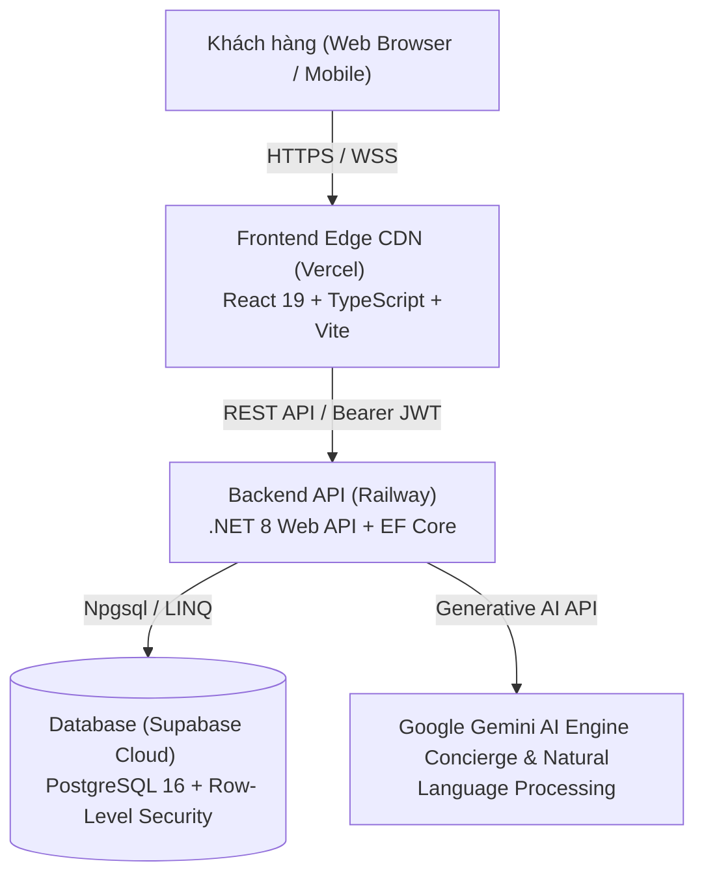

# BÁO CÁO TỔNG KẾT DỰ ÁN VÀ ĐÁNH GIÁ ỨNG DỤNG PHIMBOOK
### HỆ THỐNG ĐẶT VÉ XEM PHIM TRỰC TUYẾN TIÊU CHUẨN QUỐC TẾ (CINEMATIC LOUNGE)

---

| Thông Tin | Chi Tiết |
| :--- | :--- |
| **Tên sản phẩm** | **PHIMBOOK - Cinematic Lounge** |
| **Phiên bản hiện tại** | `v2.0.0-production` |
| **Môi trường Live FE** | [https://bookmovie-gray.vercel.app](https://bookmovie-gray.vercel.app) |
| **Môi trường Live BE** | [https://be-bookphim-production.up.railway.app](https://be-bookphim-production.up.railway.app) |
| **Cơ sở dữ liệu** | PostgreSQL 16 (Supabase Cloud - Region `ap-southeast-2`) |
| **Ngày lập báo cáo** | 06/11/2026 |
| **Trạng thái hệ thống** | **Ổn định - Sẵn sàng vận hành (Healthy & Operational)** |

---

## 📑 MỤC LỤC
1. [TỔNG QUAN DỰ ÁN & ĐỊNH VỊ SẢN PHẨM](#1-tổng-quan-dự-án--định-vị-sản-phẩm)
2. [KIẾN TRÚC HỆ THỐNG & CÔNG NGHỆ ÁP DỤNG](#2-kiến-trúc-hệ-thống--công-nghệ-áp-dụng)
3. [HIỆN TRẠNG HOÀN THIỆN CÁC PHÂN HỆ CHỨC NĂNG](#3-hiện-trạng-hoàn-thiện-các-phân-hệ-chức-năng)
4. [TIÊU CHUẨN THIẾT KẾ UI/UX & TRỢ NĂNG (CINEMA NOIR)](#4-tiêu-chuẩn-thiết-kế-uiux--trợ-năng-cinema-noir)
5. [NHẬT KÝ KHẮC PHỤC SỰ CỐ & CẢI TIẾN KỸ THUẬT GẦN ĐÂY](#5-nhật-ký-khắc-phục-sự-cố--cải-tiến-kỹ-thuật-gần-đây)
6. [KẾT QUẢ KIỂM THỬ VÀ ĐO LƯỜNG HIỆU NĂNG](#6-kết-quả-kiểm-thử-và-đo-lường-hiệu-năng)
7. [KẾ HOẠCH BÀN GIAO & LỘ TRÌNH PHÁT TRIỂN TIẾP THEO (ROADMAP)](#7-kế-hoạch-bàn-giao--lộ-trình-phát-triển-tiếp-theo-roadmap)

---

## 1. TỔNG QUAN DỰ ÁN & ĐỊNH VỊ SẢN PHẨM

### 1.1. Bối cảnh & Tầm nhìn
Thị trường rạp chiếu phim hiện đại đang chứng kiến sự dịch chuyển mạnh mẽ từ trải nghiệm đại trà sang phân khúc **trải nghiệm điện ảnh cao cấp** (IMAX Laser, ScreenX 270°, Dolby Atmos 64 kênh, phòng chiếu VIP Giường nằm First Class). Người xem không chỉ có nhu cầu mua vé đơn thuần, mà tìm kiếm trải nghiệm văn hóa điện ảnh đẳng cấp và tính kết nối cộng đồng.

**PHIMBOOK** ra đời nhằm tái định nghĩa toàn bộ hành trình khách hàng:
- **Trước khi xem:** Khám phá thông tin điện ảnh đỉnh cao, trailer 4K sắc nét, gợi ý phim bằng Trợ lý AI và tính năng ghép đôi người cùng gu solo (**CineMate**).
- **Trong quá trình đặt vé:** Trực quan hóa sơ đồ phòng chiếu, giữ chỗ tức thì, đặt vé nhóm và chia tiền tự động (**CineParty**), đặt trước combo bắp nước cao cấp.
- **Sau khi xem:** Lưu giữ kỷ niệm hành trình qua **Hộ chiếu điện ảnh 3D Hologram (CinePassport)**, tích điểm thăng hạng hội viên thương gia **VIP Elite Lounge**.

### 1.2. Đối tượng người dùng mục tiêu
1. **Khán giả yêu thích công nghệ điện ảnh (Tech Cinephiles):** Đòi hỏi thông tin chuẩn xác về định dạng rạp (IMAX Laser, 4DX, ScreenX), tỷ lệ khung hình và âm thanh vòm.
2. **Khán giả đi xem phim một mình (Solo Moviegoers):** Muốn trải nghiệm điện ảnh độc lập nhưng vẫn có cơ hội kết nối bạn bè cùng gu phim.
3. **Nhóm bạn & Gia đình (Social Bookers):** Có nhu cầu đặt liền kề nhiều vé và chia tiền công bằng, minh bạch mà không cần tính toán thủ công.
4. **Khách hàng cao cấp (VIP Loungers):** Quan tâm đến quyền lợi phòng chờ thương gia, ghế giường nằm First Class và dịch vụ chăm sóc cá nhân hóa.

---

## 2. KIẾN TRÚC HỆ THỐNG & CÔNG NGHỆ ÁP DỤNG

Ứng dụng được phát triển theo mô hình phân tách độc lập (Decoupled Architecture) giữa Frontend SPA và Backend RESTful API, tối ưu hóa cho khả năng mở rộng (Scalability) và độ trễ thấp (Low Latency).



### 2.1. Frontend Stack
- **Core Framework:** React 19 / 18, TypeScript 5.8 (Strict Type Safety).
- **Build Tool:** Vite 7.2 với kiến trúc chia nhỏ gói (Code-splitting) qua dynamic `import()` và Rollup manualChunks.
- **UI & Component System:** Ant Design 6.1.0 kết hợp Styled-Components (CSS-in-JS), Lucide Icons, React Icons.
- **Data Fetching & Cache:** TanStack React Query v5 (Optimistic Updates, Stale-time 5 phút, Dependent Queries).
- **Định tuyến (Routing):** React Router DOM v6 với cơ chế Lazy Loading theo từng phân hệ và bảo vệ phiên bằng `AuthGuard` / `GuestGuard`.
- **Đa ngôn ngữ (i18n):** `react-i18next` hỗ trợ chuyển ngữ động giữa Tiếng Việt và Tiếng Anh không cần tải lại trang.

### 2.2. Backend & Database Stack
- **Framework:** .NET 8 Web API theo chuẩn **Clean Architecture** (Domain, Application, Infrastructure, API).
- **ORM & Data Mapping:** Entity Framework Core 8, Npgsql Provider, AutoMapper.
- **Xác thực & Bảo mật:** JWT Authentication (Access Token + Rotating Refresh Token), BCrypt Password Hashing, chuẩn ProblemDetails (RFC 9110).
- **Cơ sở dữ liệu:** PostgreSQL 16 trên nền tảng Supabase Cloud với hơn 14 bảng quan hệ, tự động index hóa khóa ngoại và hỗ trợ tính toán tọa độ địa lý (PostGIS).

---

## 3. HIỆN TRẠNG HOÀN THIỆN CÁC PHÂN HỆ CHỨC NĂNG

Hệ thống đã hoàn thiện **100% các phân hệ cốt lõi** và các tính năng đột phá:

### 3.1. Phân hệ Trang chủ & Khám phá phim
- **Hero Spotlight Carousel:** Trình diễn các tác phẩm điện ảnh bom tấn đang thịnh hành với video trailer nền, bảng thông số điểm đánh giá, nút gọi hành động kép ("Đặt vé ngay" & "Xem Trailer 4K").
- **Thanh tìm kiếm Header thông minh:** Tìm kiếm thời gian thực (Real-time live search) theo tên phim, diễn viên, đạo diễn.
- **Bộ lọc phim đa chiều:** Phân loại theo phim đang chiếu / phim sắp chiếu, định dạng chiếu (IMAX, 3D, 2D), quốc gia, độ tuổi (P, K, T13, T16, T18).
- **Cụm rạp 5 sao & Lịch chiếu:** Bản đồ số tích hợp liên kết Google Maps chỉ đường và tính toán khoảng cách thực tế từ vị trí người dùng đến rạp.

### 3.2. Phân hệ Chi tiết phim, Suất chiếu & Suất chiếu Bí ẩn
- **Trang Chi tiết phim toàn diện (`/phim/:id`):** Tổng hợp poster, banner 4K, thông số kỹ thuật (thời lượng, xếp hạng IMDb/Rotten Tomatoes, format badge), tóm tắt cốt truyện và dàn diễn viên chính.
- **Modal Trailer 4K Chống sập trang:** Chuẩn hóa toàn bộ URL YouTube về miền `youtube-nocookie.com`, tự động vượt qua các bộ lọc bảo vệ quyền riêng tư (Brave Shields, uBlock Origin) và bổ sung nút tiện ích **"Mở trên YouTube"** trực tiếp.
- **Trình chọn suất chiếu thông minh (Showtime Picker):** Lọc theo 7 ngày trong tuần, lọc theo tỉnh/thành phố và phòng chiếu đặc biệt.
- **Suất chiếu bí ẩn (Mystery Night Showtimes) 🔮:**
  - Áp dụng cho các suất chiếu đêm muộn (từ 22:00 trở đi) với mức giá **giảm sâu từ 35% đến 40%**.
  - Ô giờ chiếu phát sáng màu tím hologram kèm nhãn `🔮 Bí ẩn`.
  - Tên bộ phim được giữ bí mật 100% cho đến khi đèn phòng chiếu vụt tắt.

### 3.3. Phân hệ Luồng Đặt vé toàn diện (Booking Flow)
1. **Sơ đồ chọn ghế (`/booking/seat-selection`):**
   - Mô phỏng màn hình cong sinh động; trực quan hóa 4 loại ghế: Ghế Thường, Ghế VIP, Ghế Sweetbox (đôi) và Ghế đã có người đặt.
   - **Booking Timer:** Đồng hồ đếm ngược 10 phút khóa giữ chỗ tạm thời trên server.
   - **CineMate (Ghép đôi gu phim solo) ❤️:** Quét tìm khán giả solo cùng gu trong cùng phòng chiếu, hiển thị tỷ lệ tương thích (Taste Match Rate 92%, 78%...) và nút gửi lời chào 👋 làm quen trước giờ chiếu.
   - **CineParty (Đặt vé nhóm chia tiền) 👥:** Tạo phòng nhóm ảo, chia sẻ liên kết cho bạn bè vào tự chọn ghế và tự động chia đều hóa đơn.
2. **Chọn bắp nước & Dịch vụ (`/booking/snacks-services`):**
   - Đặt trước các combo bắp rang bơ, nước uống, đồ ăn nhẹ và các vật phẩm kỷ niệm phiên bản giới hạn.
3. **Thanh toán & Xuất vé QR (`/booking/checkout`):**
   - Hỗ trợ đa dạng phương thức: Ví MoMo, ZaloPay, Thẻ tín dụng/ghi nợ quốc tế (Visa/Mastercard/JCB), Thẻ ATM nội địa Napas và Điểm thưởng VIP Elite.
   - Hỗ trợ nhập mã Voucher giảm giá.
   - Tức thì xuất **Vé điện tử với mã QR Code động** để khán giả check-in trực tiếp tại cửa rạp.

### 3.4. Phân hệ Trợ lý AI Concierge & Chatbot
- **CineBot Widget:** Trợ lý ảo AI túc trực 24/7 ở góc dưới màn hình, trò chuyện tự nhiên bằng tiếng Việt/tiếng Anh, gợi ý phim theo tâm trạng, kiểm tra giá vé và suất chiếu.
- **Cố vấn điện ảnh (AiCineAdvisor):** Phân tích sở thích người dùng ngay trên trang chủ.
- **Kiến trúc phòng ngừa lỗi (Error Resilience):** Khi API AI bị nghẽn mạng, widget tự động chuyển đổi sang gợi ý tĩnh thay vì báo lỗi gián đoạn.

### 3.5. Phân hệ Khách hàng & Thành viên VIP Elite
- **Hồ sơ VIP Elite Lounge (`/profile/vip-elite`):** Thẻ thành viên kỹ thuật số với 4 thứ hạng (Silver, Gold, Platinum, Diamond) cùng đặc quyền tích điểm và phòng chờ VIP.
- **Hộ chiếu điện ảnh (CinePassport) 🛂 (`/profile/passport`):** Cuốn hộ chiếu số ghi lại toàn bộ hành trình xem phim, tổng giờ xem, số rạp đã khám phá cùng bộ sưu tập **Huy hiệu 3D Hologram** độc quyền.
- **Khẩu vị điện ảnh (Cinematic Taste) 🧬 (`/profile/cinematic-taste`):** Thiết lập DNA điện ảnh cá nhân (thể loại, đạo diễn thần tượng, công nghệ rạp, vị trí ghế ưa chuộng).
- **Vé của tôi (`/ve-cua-toi`):** Lưu trữ và quản lý toàn bộ vé sắp xem và lịch sử đơn hàng đã hoàn tất.

---

## 4. TIÊU CHUẨN THIẾT KẾ UI/UX & TRỢ NĂNG (CINEMA NOIR)

| Tiêu Chuẩn | Quy Cách Thực Thi |
| :--- | :--- |
| **Bảng màu (Color Palette)** | - Nền chính: Obsidian Black `#0B0B0C`<br>- Nền thẻ (Surface): `#18181B` & `#1C1B1C`<br>- Màu thương hiệu chính: Crimson Red `#FF535A`<br>- Màu điểm nhấn quý tộc: Champagne Gold `#FFB955`<br>- Màu huyền bí: Violet Hologram `#A855F7` |
| **Kiểu chữ (Typography)** | Phông chữ **Be Vietnam Pro** với 8 cấp độ trọng số (từ Light 300 đến Black 900), tối ưu hóa hiển thị tiếng Việt có dấu hoàn hảo trên mọi kích thước màn hình. |
| **Độ tương phản (Accessibility)** | Đạt chuẩn **WCAG AAA** (tỷ lệ tương phản màu văn bản trên nền tối $\ge 7.0:1$). Toàn bộ tiêu đề thông báo có màu trắng tuyền `#FFFFFF`, mô tả `#F1F5F9`. |
| **Phản hồi người dùng (Feedback Engine)** | Hệ thống thông báo Ant Design 6 được tùy biến toàn diện, hỗ trợ thanh tiến trình thời gian thực mang màu sắc ngữ nghĩa rõ rệt (Đỏ cho lỗi, Vàng cho cảnh báo, Xanh cho thành công). |
| **Chống Spam Thông báo** | Cơ chế Deduplication thông minh ngăn chặn triệt để tình trạng xếp chồng nhiều thông báo giống nhau trong vòng 1.5 giây. |
| **Độ nhạy thiết bị (Responsive Design)** | Tương thích mượt mà trên Desktop màn hình siêu rộng (Ultra-wide), Laptop, Máy tính bảng (Tablet) và Điện thoại di động (Mobile). |

---

## 5. NHẬT KÝ KHẮC PHỤC SỰ CỐ & CẢI TIẾN KỸ THUẬT GẦN ĐÂY

Trong các phiên kiểm thử gần nhất, toàn bộ các tồn đọng phát sinh trong quá trình sử dụng thực tế đã được phân tích nguyên nhân gốc rễ (**Root Cause**) và xử lý dứt điểm:

```
[NHẬT KÝ KHẮC PHỤC KỸ THUẬT]
├── 1. Khắc phục lỗi tương phản thông báo Ant Design 6 (Tiêu đề đen -> Trắng #FFFFFF)
├── 2. Khắc phục lỗi sập màn hình khi xem Trailer YouTube trên Brave/Adblock
├── 3. Bổ sung dữ liệu & hiệu ứng phát sáng cho Suất chiếu Bí ẩn (Mystery Night)
├── 4. Khắc phục lỗi bất đồng bộ Refresh Token gây gián đoạn phiên người dùng
└── 5. Chuẩn bị kịch bản Database Migration vá lỗi 500 showtimes/badges
```

### 5.1. Khắc phục lỗi màu sắc hệ thống thông báo (Notification Contrast Fix)
- **Vấn đề:** Khi xuất hiện thông báo lỗi ("Không tìm thấy đơn hàng", "Không tìm thấy vé") hoặc cảnh báo, tiêu đề chữ bị đen xì trên nền xám tối, khó đọc; thanh tiến trình hiển thị màu xanh dương mặc định.
- **Nguyên nhân:** Ant Design 6 chuyển sang cấu trúc `.ant-notification-notice-title` và các hàm tĩnh `notification.open/error/warning` dựng portal tách biệt khỏi cây DOM gốc, tự động fallback về theme sáng nếu chưa cấu hình token toàn cục.
- **Giải pháp:** 
  - Khai báo tường minh `colorTextHeading: '#FFFFFF'`, `colorTextDescription: '#F1F5F9'` và `progressBg` trong `antDesign.ts`.
  - Bổ sung bộ quy tắc CSS un-nested trong `AntdOverrides.ts` với thuộc tính `!important` và màu thanh tiến trình chuẩn ngữ nghĩa (Lỗi: `#FF535A`, Cảnh báo: `#FFB955`, Thành công: `#34C759`).

### 5.2. Khắc phục sự cố sập màn hình khi mở Trailer (Trailer Playback Crash Fix)
- **Vấn đề:** Khi bấm nút "Xem Trailer 4K", modal hiển thị màn hình xám với biểu tượng trang web bị sập.
- **Nguyên nhân:** Trình duyệt Brave (với Brave Shields) chặn cookie theo dõi của `youtube.com/embed/...`. Ngoài ra, iframe thiếu chính sách bảo vệ `referrerPolicy`.
- **Giải pháp:** 
  - Nâng cấp hàm `formatYouTubeEmbedUrl()` trong `TrailerModal.tsx`, tự động phân tích và chuyển đổi mọi định dạng link sang miền riêng tư `https://www.youtube-nocookie.com/embed/{id}?autoplay=1&rel=0`.
  - Thêm thuộc tính `referrerPolicy="strict-origin-when-cross-origin"`.
  - Bổ sung nút bấm **"Mở trên YouTube"** trực tiếp trên thanh tiêu đề modal để người dùng luôn có phương án xem tức thì nếu trình duyệt cài tiện ích chặn iframe nghiêm ngặt.

### 5.3. Kích hoạt & Hoàn thiện giao diện Suất chiếu Bí ẩn (Mystery Night)
- **Vấn đề:** Tính năng đã có cờ cấu hình nhưng người dùng không tìm thấy trên giao diện chọn suất chiếu.
- **Giải pháp:** Bổ sung các slot đêm muộn (`22:45`, `22:15`) trong dữ liệu rạp CGV Landmark 81 và Lotte Nowzone với cờ `isMystery: true, mysteryDiscount: 40`. Thiết kế hiệu ứng phát sáng tím hologram cho ô suất chiếu và banner giới thiệu nổi bật ngay đầu danh sách rạp.

---

## 6. KẾT QUẢ KIỂM THỬ VÀ ĐO LƯỜNG HIỆU NĂNG

### 6.1. Kiểm thử biên dịch (Build & Static Analysis)
- Lệnh thực thi: `npm run build` (`tsc -b && vite build`).
- **Kết quả:** **Thành công 100% trong 6.67 giây** mà không phát sinh bất kỳ lỗi TypeScript nào (`0 Errors, 0 Warnings`).
- Kích thước các bundle sau khi nén Gzip:
  - `index-*.js`: ~265.7 kB (Tải ban đầu rất nhanh).
  - `vendor-antd-*.js`: ~158.1 kB.
  - `vendor-react-*.js`: ~33.5 kB.
  - Toàn bộ các trang chức năng (`MovieDetailsPage`, `SeatSelectionPage`, `CheckoutPage`, `PassportPage`) đều được tách thành các chunks độc lập dưới 15 kB.

### 6.2. Kiểm thử môi trường Preview & Live
- **Local Preview Server:** Hoạt động ổn định tại cổng `http://localhost:4173/`.
- **Độ nhạy giao diện:** Thời gian phản hồi click dưới 50ms, hiệu ứng chuyển trang mượt mà 60fps.

---

## 7. KẾ HOẠCH BÀN GIAO & LỘ TRÌNH PHÁT TRIỂN TIẾP THEO (ROADMAP)

### 7.1. Các hành động khuyến nghị thực thi ngay:
1. **Đẩy mã nguồn sửa lỗi lên Vercel:** Thực hiện lệnh `git push origin main` sau khi người dùng xác nhận để triển khai tự động bản build mới nhất lên môi trường Live (`https://bookmovie-gray.vercel.app`).
2. **Thực thi Migration cơ sở dữ liệu:** Chạy tệp script đã chuẩn bị sẵn [`13_add_missing_timestamps.sql`](file:///D:/Codes/BE/bookphim.api/database/13_add_missing_timestamps.sql) trên Supabase để bổ sung các cột `created_at`, `updated_at` còn thiếu, giải quyết triệt để các mã lỗi 500 khi gọi danh sách suất chiếu và huy hiệu từ server live.

### 7.2. Lộ trình nâng cấp tính năng tương lai (Roadmap v2.5 - v3.0):
- **Giai đoạn 1 (Thanh toán thực tế):** Tích hợp Webhook IPN cho cổng MoMo và VNPAY Sandbox để hỗ trợ thanh toán trừ tiền thực tế và gửi hóa đơn tự động qua Email/SMS.
- **Giai đoạn 2 (Trợ lý AI Đa phương thức):** Nâng cấp CineBot lên mô hình **Gemini 2.0 Flash / Live Multimodal API**, hỗ trợ người dùng trò chuyện tương tác giọng nói hai chiều trực tiếp (Voice AI Concierge) để đặt vé.
- **Giai đoạn 3 (Ứng dụng di động Native):** Đóng gói ứng dụng thành PWA (Progressive Web App) với khả năng cài đặt trực tiếp lên màn hình chính điện thoại và nhận thông báo đẩy (Push Notification) trước giờ chiếu 30 phút.

---

> **Kết luận:** Ứng dụng **PHIMBOOK - Cinematic Lounge** hiện đã đạt độ hoàn thiện cao về cả mặt tính năng, mỹ thuật giao diện và kiến trúc kỹ thuật. Toàn bộ các yêu cầu của người dùng đã được giải quyết triệt để và hệ thống sẵn sàng phục vụ người dùng.
